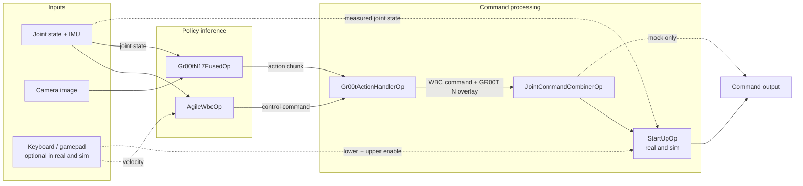

# Unitree G1 GR00T N1.7 and WBC

This application combines Agile WBC locomotion with GR00T N1.7 arm and hand control
on Holoscan SDK 5.

For a guided deployment of compatible ONNX models exported by the reference workflow, start with
[GR00T N and whole-body control](../../docs/tutorials/gr00t_wbc.mdx):
[Simulation](../../docs/tutorials/gr00t_wbc/simulation.mdx) or
[Real robot](../../docs/tutorials/gr00t_wbc/real_robot.mdx).
This reference describes the application, its cached models and configuration.

| Mode | Executable | Inputs and outputs |
| --- | --- | --- |
| [`mock`](#mock) (default) | `mock_gr00t_n1_7_wbc_g1` | Deterministic robot state and GPU images; a sink validates the combined commands |
| [`sim`](#isaac-sim) | `sim_ucx_gr00t_n1_7_wbc_g1` | Isaac Sim joint state, IMU, and ego-view camera over UCX |
| [`real`](#real-robot) | `real_gr00t_n1_7_wbc_g1` | Unitree DDS state and commands, V4L2 camera capture, startup sequencing, and optional keyboard/gamepad input |

Isaac Sim uses a different model and timing profile from mock and real modes.
See [configuration](#configuration) and [application modes](../../docs/explanation/application_modes.mdx).
For locomotion only, use [G1 WBC](../wbc_g1/README.md).

[Benchmark](BENCHMARK.md)

## Architecture

Real, Isaac Sim, and mock modes share the WBC and GR00T N control pipeline:

- `AgileWbcOp` generates locomotion commands from joint state and IMU.
- `Gr00tN17FusedOp` predicts arm and hand actions from camera images and joint state.
- On each WBC command, `Gr00tActionHandlerOp` selects the GR00T N action for the camera frame's
  age and forwards the WBC command unchanged.
- `JointCommandCombinerOp` combines 15 WBC leg/waist joints with 28 GR00T N arm/hand joints.
- In real and sim, `StartUpOp` follows the combiner and receives measured joint state
  and optional keyboard/gamepad enable signals.

### Control graph

Sensor adapters, transport internals, validation taps, and optional display are omitted.
The handler's two command outputs share one connector.



GR00T N runs five TensorRT engines inside `Gr00tN17FusedOp`:

```text
preprocess_video → preprocess_state → backbone → action_head → decode_action
```

### GPU execution

The [fused operator](../../operators/gr00t_n1_7/gr00t_n1_7_fused_op.cu) reuses
fixed-address buffers and submits work to the CUDA stream supplied by
`ExecutionContext`. Inputs are float32 joint positions and contiguous uint8 images.
Camera frame dimensions must stay constant for the run.
After one eager warmup, execution uses these capture boundaries:

- Outside capture: input copies and fresh noise generation.
- Captured: CUDA image preparation (crop, drop extra channels, cast to float),
  MatX joint gather and action scatter, all five TensorRT engines, and output
  copies into pinned host buffers.
- After replay: the CPU waits for completion, constructs the outgoing action
  message, and emits it.

<details>
<summary>❓ Why combine preprocessing, inference, and postprocessing?</summary>

The image kernel combines cropping, channel selection, and byte-to-float conversion
in one pass, avoiding intermediate images. MatX gathers joint positions into model
order and scatters predicted actions into joint-major outputs.

Capturing the chain reduces repeated CPU submission that can contend with the
50 Hz WBC loop. Stream ordering connects the GPU stages without intermediate CPU
waits. Replay preserves the individual kernels; GPU partitioning separately controls
SM allocation.

Stable buffers accept fresh values without rebuilding the graph. Captured shapes
and image-kernel launch parameters require fixed camera dimensions. Pinned,
fixed-address output buffers allow asynchronous device-to-host transfers to be
captured with the computation.

Combining stages also shares their scheduling and queue boundaries, so backpressure
and fault handling apply across the combined work.

</details>

See [Optimize an Application](../../docs/how-to/optimize_an_application.mdx#programming-guidelines-for-improving-determinism)
for general guidance and the [benchmark](BENCHMARK.md#results) for measured results.

### Mode differences

| Responsibility | Real | Isaac Sim (`sim`) | Mock |
| --- | --- | --- | --- |
| Entry point | [real/main.cc](real/main.cc) | [sim/main.cc](sim/main.cc) | [mock/main.cc](mock/main.cc) |
| State and IMU | DDS subscriber | UCX interface with paired sensor samples | Deterministic robot state source |
| Camera | V4L2 capture | UCX image-to-tensor adapter | Deterministic GPU images |
| Command output | DDS publisher | UCX sender | Validation sink, also checking handler outputs |
| Startup placement | `StartUpOp` after combiner, before publisher | `StartUpOp` after combiner, before UCX sender | No startup operator |
| Startup behavior | Measured-pose input, waypoints, then enable gate | Two-second measured-pose blend into GR00T N; WBC remains active | No startup gate |
| Clock | Wall time | Simulator-driven synthetic time | Wall time |

The WBC, action handler, combiner, and command output share a control partition, together
with the mode's state source/adapter and startup operator where present. GR00T N and image
input run separately. Sim transport and optional visualization also run separately.

The [UCX interface subgraph](../../operators/unitree_sim_ucx/unitree_sim_ucx_subgraph.h)
encapsulates simulator transport, sensor pairing, and clock advancement. The
[green-context helper](green_context.cc) configures WBC GPU isolation. Mock sources and
command validation live in [mock/mock_operators.cc](mock/mock_operators.cc).

## Run

Run commands from the repository root. The Isaac OS CLI builds and runs in the
project's HSDK5 container. CUDA Green Context is enabled by default and requires GPU
and driver support for SM partitioning. Use `--green-context-wbc-sms=0` to disable
partitioning. A CUDA-capable GPU is still required. The first build downloads the WBC policy and
GR00T N model resources. TensorRT engines are cached on first use.

```bash
./isaac_os build gr00t_n1_7_wbc_g1
```

In all three modes, Ctrl+C requests shutdown and waits for operator cleanup
and CUDA work. Press it again to force termination if cleanup hangs. A signal
during configuration cancels the run before the graph starts.

Choose one mode and launch one controller. In real and sim, add `--gamepad` to enable
keyboard/gamepad input; a keyboard connected to the app host is sufficient. Complete
[device setup](#device-setup) before launching with that flag, then follow the shared
[controls](#controls). Without `--gamepad`, WBC uses the configured static locomotion
velocity (zero by default).

GR00T N controls the arms and hands with or without `--gamepad`.

<Tabs>

<Tab title="Mock" id="mock-run-tab">

### Mock

Run until Ctrl+C:

```bash
./isaac_os run gr00t_n1_7_wbc_g1 mock
```

A finite run validates that combined commands contain the expected WBC and
GR00T N joint values. Allow enough messages for GR00T N to produce usable actions:

```bash
./isaac_os run gr00t_n1_7_wbc_g1 mock -- \
  --message-count=500
```

</Tab>

<Tab title="Isaac Sim" id="sim-run-tab">

### Isaac Sim

#### Isaac Sim prerequisites

Set up [Isaac Sim](../../docs/how-to/set_up_isaac_sim.mdx). The scene needs network
access for online assets; TensorRT engine creation can take several minutes.

Simulator and controller run on x86_64 and use port `50008`. Run one controller
per endpoint.

<Warning>

Isaac Sim up to 6.2.1.0 ignores PD gains (`kp` and `kd`) received through UCX.
Changing command gains does not change simulated stiffness or damping; tune the USD
articulation drives instead. See [joint-command gains](../../docs/how-to/set_up_isaac_sim.mdx#configure-joint-gains)
for details.

</Warning>

#### Isaac Sim quick start

Start the apple scene in terminal 1:

```bash
./isaac_sim run --scene operators/unitree_g1/assets/g1_static_apple_ucx.usda \
  -- --substeps 4
```

Start the controller in terminal 2:

```bash
./isaac_os run gr00t_n1_7_wbc_g1 sim
```

The default launch automatically hands upper-body control to GR00T N. Add `-- --gamepad`
to require startup enables, or `-- --holoviz` for an RGB camera window. Both flags
can be combined. HoloViz needs a display and is not required for inference.
See [Controls](#controls) for enable and hold behavior.

Sim performs a two-second blend from the measured upper-body pose into GR00T N
commands. WBC retains lower-body authority. Keep locomotion at zero for the
apple scene. The policy continues running after placement.

Ctrl+C stops the controller; the simulator resets and listens for a new connection.
Restart the controller for each episode. The [simulation tutorial](../../docs/tutorials/gr00t_wbc/simulation.mdx)
covers readiness, task observation, shutdown and repeated attempts.

</Tab>

<Tab title="Real robot" id="real-run-tab">

### Real robot

For the real robot, set `camera.device` in [config/control.yaml](config/control.yaml)
to the color V4L2 node. The default is `/dev/video4`, with YUYV capture at 640 × 480 and 30 FPS. The
camera must support the requested dimensions and tightly packed YUYV rows. Frames
are converted to RGB on the GPU for GR00T N.

Choose the robot-facing interface from `ip -brief link`, then replace `enP2p1s0` below
with that interface name:

```bash
./isaac_os run gr00t_n1_7_wbc_g1 real -- \
  --network-interface enP2p1s0 --gamepad
```

Real mode uses DDS domain 0 by default; `--domain-id <N>` overrides it.
`--network-interface` overrides the YAML's `unitree_g1_robot.network_interface`.
The configured 43 joints include the G1 body
and both Dex 3-1 hands. Stop with Ctrl+C.

#### Startup

> **Warning:** Real mode produces startup motion before the enable gate.
> Enable keys, upper-body hold and Ctrl+C are not an emergency stop. Follow the
> robot operating procedure to secure the robot and stop or abort motion.

Real mode always runs the waypoint routine referenced by `start_up.config_file`,
then holds its final pose until lower-body enable or the configured timeout.
The shipped `start_up.auto_enable_delay` is **60 seconds after reaching the final
pose** when no gamepad is enabled. The delay releases both the lower body and the
configured upper-body hold. With `--gamepad`, the delay is ignored and lower- and
upper-body control wait for their respective enable signals. Zero permits immediate
release at the final pose when no gamepad is enabled.

Lower-body enable can be latched during startup. It releases the gate after the
routine finishes; the joints selected by `start_up.upper_body_joints` remain held
until upper-body enable. Upper-body enable toggles between controller commands
and the startup hold pose. Without `--gamepad`, WBC uses the static velocity command
from `gr00t_wbc` (zero in the shipped configuration).

See [Controls](#controls) for startup enables and locomotion inputs.

</Tab>

</Tabs>

## Model export contract

The runtime consumes five ONNX models and their external weight files, configured
through Isaac OS YAML. LEAPP is the upstream export tool that produces these
artifacts; the runtime does not directly ingest a LEAPP bundle or its metadata YAML.

`--model-config-path` takes the Isaac OS model YAML with the five ONNX paths and
their tensor bindings. Joint mappings and action timing come from the application
YAML. Retain LEAPP metadata for compatibility checks; it is not a runtime input.
A training checkpoint must be exported before use. Preserve every ONNX
external-data file beside its model.
The [deployment tutorials](../../docs/tutorials/gr00t_wbc.mdx) show how to bind
compatible exports without overwriting the build-managed cached models.

| Contract | Simulation | Physical robot and mock |
| --- | --- | --- |
| Model configuration | `operators/gr00t_n1_7/config/n1_7_g1_apple_sim_trt.yaml` | `operators/gr00t_n1_7/config/n1_7_g1.yaml` |
| Application mapping | `sim.gr00t_n1_7` in `config/control.yaml` | Top-level `gr00t_n1_7` in `config/control.yaml` |
| Decoded action horizon | 40 | 16 |
| Action interval | 0.02 seconds | Approximately 1/30 second |
| State groups | Waist, arms and hands | Legs, waist, arms and hands |
| Action decoding | Absolute actions without arm reference inputs | Arm reference inputs from state preprocessing |
| Cached model | `nvidia/GN1x-Tuned-Arena-G1-Static-PickNPlace` at `7f78bebf1a90131e7304beacfcd47eb27bad16ab`, `exports/g1-static-apple-b1-480x640/onnx/leapp-0.5.2` | `nvidia/GR00T-N1.7-ApplePnP-V1` at `90caf594a5f1ce32e114103d6debf3ffabdb802d` |

Both profiles use a 640 × 480 RGB ego-view image, 43 robot joints and five ONNX
stages: video preprocessing, state preprocessing, backbone, action head and action
decoding. WBC supplies 15 leg/waist joints; GR00T N supplies 28 arm/hand joints.
The combiner does not use predicted navigation or base-height commands to drive
locomotion; WBC uses the configured static velocity or teleop input.

Compatibility includes tensor names, shapes and dtypes, image preprocessing,
normalization, state and action joint order, position/effort semantics, and action
timing. State and action hand orders differ: compare `state_output_spec` and
`input_spec` separately. Export metadata documents these semantics but is not
imported automatically. Matching filenames, joint counts or horizons is insufficient.
Differences may require model binding or application configuration changes.
Custom operators are needed when the existing operators cannot express the
export's preprocessing, inference or action semantics. These adaptations are
outside the compatible-export tutorials.

The cached simulation export is a concrete compatibility baseline. A newly trained
reference-workflow checkpoint is not automatically interchangeable with it, and
Isaac Lab-Arena evaluation does not establish behavior in the Isaac OS apple scene.
Model loading and mock execution do not validate joint semantics or task success.

## Configuration

### Real and mock

Both launchers use [config/control.yaml](config/control.yaml) for the application and
[the G1 GR00T N model configuration](../../operators/gr00t_n1_7/config/n1_7_g1.yaml)
via `--model-config-path`.

GR00T N, WBC, action handling, the combiner, and green-context settings are shared.
Real mode also reads the camera, DDS, startup, teleop, and thread-pinning sections.

The startup routine is selected by `start_up.config_file`; waypoint and dwell
durations use `start_up.control_dt`. Teleop accepts symbolic evdev names such as
`ABS_X` and `BTN_TL`, as well as numeric codes.

To use a copy of the application YAML, pass its path after the launcher's `--`:

```bash
./isaac_os run gr00t_n1_7_wbc_g1 mock -- \
  --application-config-path=path/to/control.yaml
./isaac_os run gr00t_n1_7_wbc_g1 real -- \
  --config-path=path/to/control.yaml --gamepad
```

Paths inside the YAML are resolved from the repository root. `--override` arguments are not
supported by these binaries; edit the YAML instead.

For real and mock modes, control is configured at 50 Hz and images at 30 Hz. An image-driven gate
selects the first frame in each fixed 0.2-second capture-time interval (nominally 5 Hz), including
the initial interval. Missed intervals are skipped. Actual throughput depends on processing time.

Joint state is selected at or before image capture; the last selected state is reused when no
eligible sample is available. Inference starts once an eligible state is available. The input
queues retain one image and four states with drop-oldest overflow. Image and state timestamps
must use a common clock.

Real and mock modes use the 16-step G1 apple-to-plate model and
combine 15 leg/waist joints from WBC with 28 arm/hand joints from GR00T N.

Action selection runs on each WBC command. The configured spacing between predicted
actions is approximately 1/30 second, and the combiner's GR00T N startup delay is
1 second. These are separate from the 0.2-second inference period and the real
robot's startup gate.

### Isaac Sim

The `sim` sections of [control.yaml](config/control.yaml) configure GR00T N, action
handling, the startup blend, the combiner and HoloViz. The default model configuration is
[the apple simulation model](../../operators/gr00t_n1_7/config/n1_7_g1_apple_sim_trt.yaml),
selected with `--model-config-path`. Model resources are under
`data/gr00t_n1_7/g1_static_apple_sim/`. Do not substitute the mock/hardware model
when evaluating the apple scene.

The simulation model outputs commands for 43 motors.

| Setting | Default / purpose |
| --- | --- |
| `--hostname` / `--port` | `127.0.0.1` / `50008`; simulator endpoint |
| `--application-config-path` | Application YAML; `--config-path` is an alias |
| `--model-config-path` | GR00T N model YAML selected by the mode |
| `--gamepad` | Enable keyboard/gamepad locomotion and startup-enable inputs; off by default |
| `--holoviz` | Optional camera window; off by default |
| `--compile-only` | Compile the graph without connecting or running operators; CUDA is required |
| `--green-context-wbc-sms` | Overrides the YAML WBC SM count; default is the device quantum; zero disables partitioning |
| `sim.gr00t_n1_7.inference_period` | `0.7` simulation seconds |
| `sim.gr00t_n1_7.align_observations` | `true`; infer from camera/state pairs with identical capture timestamps |
| `sim.gr00t_action_handler.action_interval_s` | `0.02` simulation seconds between trained actions |
| `sim.gr00t_action_handler.handover_blend_steps` | `3.0`; blend between successive chunks |
| `sim.start_up.handover_duration` | `2.0`; initial upper-body handover duration in seconds |
| `sim.joint_command_combiner.overlay_startup_delay_s` | `0.0`; no additional overlay delay |
| `sim.holoviz` | Window size and title |

Sim uses the same Green Context defaults and overrides as real and mock, described
in [GPU and CPU placement](#gpu-and-cpu-placement).

For a different endpoint, start the simulator with `--port 50019` and run:

```bash
./isaac_os run gr00t_n1_7_wbc_g1 sim -- \
  --hostname 127.0.0.1 --port 50019
```

Use the remote simulator hostname when running across hosts. Edit a copy of the application YAML
for timing or command changes; `profiles.sim.*` override blocks are not this app's interface.
To change simulated stiffness or damping, edit the drive gains in
[g1_static_apple_ucx.usda](../../operators/unitree_g1/assets/g1_static_apple_ucx.usda) for the
upper body, or its [base scene](../../operators/unitree_g1/assets/g1_ucx.usda) for the lower body.

## Keyboard and gamepad

These controls apply to **both G1 WBC and GR00T N + WBC**, in real and `sim` modes.
Isaac Sim keyboard/gamepad teleop runs on x86_64.
Pass `--gamepad` to enable both keyboard and gamepad readers; devices, speeds, and mappings
come from the top-level `gamepad` section of the app's YAML. Without the flag, WBC uses
configured static velocities. Mock mode does not accept teleop input.

Velocity controls, gamepad arming, and the deadman trigger behave the same in real and sim.
In GR00T N + WBC, `O` / `R1` toggles upper-body hold in both real and sim. Real holds its
final startup waypoint; sim holds the measured pose captured at the initial handoff.
Startup enables do not affect WBC-only sim. Teleop changes locomotion velocity
while GR00T N controls the arms and hands.

### Device setup

Input comes from Linux **evdev devices on the machine running the app**. Typing in an SSH
terminal does not send teleop input. Connect the keyboard or controller to the app host.
Select `gamepad.gamepad_device` and `gamepad.keyboard_device` using an evdev path,
a case-insensitive device-name substring, or an empty string for automatic discovery.
List device names and paths with:

```bash
cat /proc/bus/input/devices
```

The selected `/dev/input/event*` nodes must be readable inside the app container.

Built-in mappings support DualSense controllers with the `playstation` or
`hid-generic` driver. Connect the controller before launch when using a built-in
mapping. Other controllers need a custom mapping in the `gamepad` section:

```yaml
use_configured_gamepad_mapping: true
gamepad_mapping:
  axes:  # Forward, sideways, turn.
    - {code: ABS_Y, invert: true}
    - {code: ABS_X, invert: true}
    - {code: ABS_RX, invert: true}
  deadman: {axis: ABS_Z, threshold: 200}
  lower_body_enable_button: BTN_TL
  upper_body_enable_button: BTN_TR
```

Choose the evdev codes for the actual controller. A custom mapping must specify all
three axes, the deadman axis, and the lower-body button. The upper-body button is
optional; keyboard `O` remains available in real and sim when it is omitted.

### Controls

In real mode and GR00T N + WBC sim with `--gamepad`, press `P` then `O` on the keyboard,
or `L1` then `R1` on a PS5 controller, for startup enables. WBC-only sim does not need
startup enables. The mappings below describe each button's effect.

`P` enables lower-body startup once per run; pressing it again does not disable it.
After releasing the upper-body hold, pressing `O` / `R1` again gradually returns the upper
body to its startup pose while WBC continues balancing. It does not freeze the arms at
their current position. Press again to resume controller commands.

For the apple-to-plate task, leave locomotion at zero and arrange the apple and plate for
the selected model. Sim supplies the apple scene; real mode requires the physical task setup.
GR00T N controls grasping, lifting, and placement. The policy continues running after placement
and may move the apple again.

| Keyboard | Action |
| --- | --- |
| Hold `W` / `S` | Forward / backward velocity |
| Hold `A` / `D` | Left / right velocity |
| Hold `Q` / `E` | Left / right turn velocity |
| `P` | Latch lower-body startup enable in real and GR00T N + WBC sim |
| `O` | Toggle between upper-body startup hold and controller commands in real and GR00T N + WBC sim |
| Hold `Space` | Zero keyboard velocity while held; movement resumes on release if movement keys remain held |

The built-in PS5 DualSense mappings use the following physical controls with either
supported driver. A custom `gamepad_mapping` overrides these defaults.

| PS5 DualSense control | Action |
| --- | --- |
| Left stick up / down | Forward / backward velocity |
| Left stick left / right | Left / right velocity |
| Right stick left / right | Left / right turn velocity |
| `L1` (left shoulder button) | Arm/disarm gamepad velocity input; also latch lower-body startup enable in real and GR00T N + WBC sim |
| `R1` (right shoulder button) | Same startup action as keyboard `O` |
| Hold `L2` (left trigger) | Allow stick velocity commands while armed; squeeze past the deadman threshold (raw value greater than 200 out of 255) |
| Release `L2` | Command zero velocity while armed; the gamepad retains ownership of velocity input |

Releasing movement keys returns keyboard velocity to zero.
Disarming or disconnecting the gamepad returns velocity control to the keyboard.
It does not reset the startup enable latch. A custom mapping uses the same arming
and deadman behavior as the built-in controls above.

The default per-axis linear speed is 0.5 m/s, and turn speed is 0.5 rad/s. Keyboard
`Space` affects keyboard velocity input; it does not stop GR00T N arm commands or
an armed gamepad's velocity input.

<details>
<summary>⚠️ No teleop response</summary>

- Confirm the app was launched with `--gamepad` and the input device is connected to the app host.
- Check device discovery messages in the app log and that the selected event nodes are readable
  inside the container. If discovery selected the wrong device, set its name or path explicitly.
- If the keyboard appears ignored, disarm the gamepad with `L1`. An armed gamepad owns velocity
  input even with `L2` released.
- For stick input, arm with `L1` and hold `L2` beyond its threshold. In real mode, the startup
  routine and lower-body enable must also complete before locomotion commands take effect.

</details>

## GPU and CPU placement

By default, CUDA Green Context reserves the device's minimum SM allocation (the device quantum)
for WBC; other GPU work shares the remaining SMs.

Override the WBC SM count with the command-line option `--green-context-wbc-sms=<N>`
or the `green_context.wbc_sms` parameter in the application YAML. The command-line
option takes precedence over YAML.

Setting the WBC SM count to zero disables Green Context. Use
`--green-context-wbc-sms=0` or set it in YAML:

```yaml
green_context:
  wbc_sms: 0
```

A positive count must satisfy the device's minimum size and alignment requirements
and leave at least one quantum for other GPU work. The app exits with an error if
the GPU or driver cannot support the requested allocation.

Real mode's `operator_pinning.enable` defaults to `false`. When enabled, `wbc_core`
and `gr00t_core` select CPU cores, and `wbc_priority` and `gr00t_priority` set
`SCHED_FIFO` priorities. The selected cores and scheduling privileges must be
available in the container.

Mock accepts `--benchmark-controller-core`, `--benchmark-background-core`,
`--benchmark-gr00t-core`, and `--benchmark-wbc-core`; supply all four together.
`--benchmark-affinity-only` applies those affinities without real-time scheduling.

## Simulation timing and action playback

The [UCX interface subgraph](../../operators/unitree_sim_ucx/unitree_sim_ucx_subgraph.h)
owns transport and sensor pairing; [sim/main.cc](sim/main.cc) wires it to the control
and inference operators. The handler forwards every WBC command, including before
GR00T N produces its first action.

- Physics runs at 200 Hz; `--substeps 4` gives 50 Hz control.
- Dedicated UCX time messages advance the graph's `SyntheticClock`. State and image messages
  retain their upstream simulation capture timestamps.
- WBC uses exact timestamp alignment between joint-state and IMU messages, with a
  zero-nanosecond alignment window. GR00T N also pairs state and image by exact capture timestamp,
  selecting the first available pair in each new 0.7-second simulation-time interval after the
  initial interval. Its state input retains four samples while waiting for camera delivery.
  Missed intervals are skipped.
- GR00T N predicts 40 actions. On each WBC command, `Gr00tActionHandlerOp` selects the action
  corresponding to the camera frame's age, using the simulation model's 0.02-second action
  interval. It interpolates between actions and blends chunk handovers over three action steps.
  The selected overlay is emitted before its matching WBC command reaches the combiner.
  This accounts for inference latency rather than starting each chunk at its arrival time.
- The combiner takes lower-body/waist commands from WBC and configured upper-body/hand commands
  from GR00T N. Before a valid overlay arrives, it forwards the WBC command marked as degraded.
  Startup preserves lower-body commands and holds the upper body until a non-degraded
  command and any required enables arrive.
  The sim profile sets the additional overlay delay to zero.
- Connection is deferred until all operators finish startup, allowing model initialization
  before the simulator begins stepping. This is not a fixed sleep or a guarantee that the
  first GR00T N action is already available.
- Simulation-time scheduling does not make inference instantaneous: late results and missing
  inputs can still affect behavior.

## Troubleshooting

For connection failures, readiness checks and repeated attempts, see the
[simulation tutorial](../../docs/tutorials/gr00t_wbc/simulation.mdx).
For physical model and device checks, see the
[real-robot tutorial](../../docs/tutorials/gr00t_wbc/real_robot.mdx).

- A non-monotonic clock error can follow a simulator reset while the controller
  remains alive. Restart the controller for a new episode.
- `RUNTIME_OPERATOR_CALLBACK_FAILED` identifies a callback failure; inspect both
  controller and simulator logs for the failing operator or simulation step.
- TensorRT may warn about INT64 bindings between GR00T N models on first build.
  The fused operator allocates those buffers; no action is needed when engine
  creation succeeds and the app reports `accelerated inference is ready`.

## Benchmark capture

Real and mock modes emit native Holoscan operator-centric logging markers for Nsight Systems.
Capture the mock pipeline on AGX Thor from the repository root:

```bash
mkdir -p build/benchmarks
./isaac_os run gr00t_n1_7_wbc_g1 mock \
  --nsys-args='--trace=nvtx --sample=none --backtrace=none --cpuctxsw=none --force-overwrite=true -o /workspace/isaac_os/build/benchmarks/gr00t-wbc' \
  -- --message-count=500
```

Use [Profile an Application](../../docs/how-to/profile_an_application.mdx) to export SQLite with
`--include-blobs=true` and run `data_flow_tracking`. It reports source compute start
to sink compute end; select an exact port path and warmup window for comparisons.
The app no longer accepts `--metrics-path`. Real and mock modes do not expose `--holoviz`.

See [Benchmark](BENCHMARK.md) for results, longer captures, and the exact WBC
joint-state-to-command and GR00T N image-to-command paths.

<details>
<summary>❓ How are signals handled during profiling?</summary>

Real and mock handle SIGTERM from timed Nsight captures through the same shutdown
path as Ctrl+C. Profiler threads may already exist at startup; no special signal
handling flag is needed.

</details>
