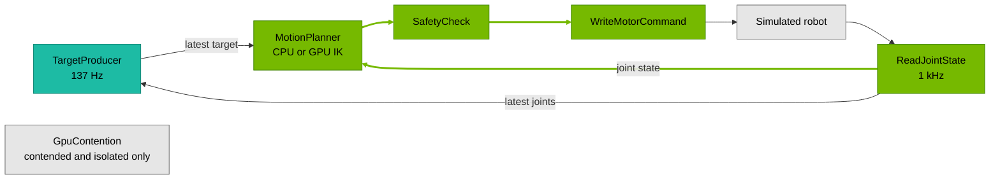

# Robot control benchmark

This benchmark measures latency and command timing of a 1 kHz control loop for a simulated
7-DoF arm, using the latest target from an independent 137 Hz producer. GPU runs solve
inverse kinematics through a parallel search on the GPU, comparing clean, contended, and
CUDA Green Context-isolated execution. CPU runs solve inverse kinematics on the CPU,
comparing clean execution with host-side `stress-ng` load.
CPU and GPU IK perform different workloads, so compare conditions within each backend.
These measurements exclude physical sensors, robot communication, and actuator response.

The primary metric, **scheduled activation → joint-command completion**, starts when the control
tick is due and ends when its command is written to the simulated robot. It captures both the
delay before execution and the time spent computing the command.

## Methodology

### Control loop



| Stage | Work performed |
| --- | --- |
| **ReadJointState** | Reads simulated joint positions and records the scheduled activation and actual callback-entry timestamps. |
| **MotionPlanner** | Uses the latest complete target to compute joint setpoints with the selected IK backend. Reuses that target until a newer one arrives. |
| **SafetyCheck** | Applies finite-value, joint-range, and step checks, then encodes the command batch. |
| **WriteMotorCommand** | Copies the encoded command batch to a send buffer, applies it to the simulated robot, and records completion. |
| **TargetProducer** | Generates a six-dimensional target pose along a trajectory, using the latest joint state. Runs independently of the control loop. |
| **GpuContention** | Runs a matrix-multiplication workload independently, competing with GPU IK in the loaded scenarios. |

### Scenarios and workloads

| Scenario | Application mode | Background work | What it exercises |
| --- | --- | --- | --- |
| CPU clean | `cpu` (default) | None | CPU scheduling and control-path latency. |
| CPU contended | `cpu`, with an external CPU workload | Normal-priority CPU load | FIFO control scheduling when background work competes for CPU time. |
| GPU clean | `gpu-clean` | None | GPU control-path latency, including host/device transfers and completion handling. |
| GPU contended | `gpu-contended` | GPU matrix multiplication | Interference when control and background work share default CUDA placement. |
| GPU isolated | `gpu-isolated` | The same GPU matrix multiplication | CUDA Green Context SM partitioning to limit interference. |

The `gpu-contended` and `gpu-isolated` modes run the same operators, rates, and workloads. Their
difference is GPU placement: isolated mode reserves one structured group of streaming
multiprocessors (SMs) for control and assigns the remaining structured SMs to the background
load. This requires a GPU with sufficient CUDA Green Context resources.

On AGX Thor, isolated mode assigns two SMs to control and the remaining 18 to the background load.

Both backends use the same arm model. The CPU backend updates a single starting configuration,
while the GPU backend searches many candidates in parallel:

- **CPU IK:** four double-precision damped least-squares iterations starting from the measured
  joint configuration, with fixed damping and per-iteration joint-step limits.
- **GPU IK:** 1,024 reproducible starting configurations, each with four single-precision
  iterations. The solver selects a bounded command based on pose error and joint movement,
  or holds the bounded measured configuration if no candidate improves its score.

GPU IK replays a CUDA graph containing input upload, candidate solves, selection, and result
download. The control thread spin-polls a CUDA completion event until the result reaches host
memory. This trades CPU utilization for lower completion latency. Graph preparation happens
on the active stream, including the Green Context stream; keep warmup enabled.

The background GPU operator repeatedly runs bursts of 42 BF16 matrix multiplications
(4096 × 4096), reusing fixed-seed pseudorandom inputs and overwriting one output buffer.
A 10 µs clock coalesces missed ticks; each burst finishes before the next starts, leaving
small scheduling gaps between bursts.

CPU clean and CPU contended use the same CPU IK application. CPU contention comes from an
external workload, such as normal-priority `stress-ng` arithmetic workers pinned to the CPUs
under test. The control thread retains FIFO priority. Record the stressor method, CPU placement,
and load level with the results: arithmetic load exercises a different kind of interference
from memory or I/O stress. The application does not launch or supervise CPU stressors.

### Metrics

The application reports sample count, median (P50), P99.99, and maximum in microseconds
for each distribution. The three bold metrics below lead the report.
These runs use no Nsight Systems capture or trace analysis.

| Metric | Meaning |
| --- | --- |
| **Scheduled activation → joint-command completion** | Primary control-loop latency: scheduling delay plus the complete read-to-write path. At 1 kHz, each command has a 1,000 µs deadline from its scheduled activation. |
| **Scheduled activation → joint-read callback entry** | Delay from the scheduled tick to the start of the read callback, including runtime and OS scheduling. |
| **Target produced → first completed joint-command using that target** | Responsiveness to a new target, including waiting for a control tick. Counts only the first completed command using each target. |
| Joint-read callback entry → joint-command completion | Time inside the control path after the read callback begins. Excludes its initial scheduling delay. |
| Interval between successive joint-read callback entries | Observed control-loop cadence. The nominal interval is 1,000 µs at 1 kHz; skipped ticks remain visible as longer intervals. |

Read latency together with the correctness counters:

- **Late commands:** commands completed after their scheduled deadline.
- **Coalesced ticks:** scheduled activations skipped by runtime coalescing.
- **Dropped ticks:** control samples lost downstream, tracked separately from coalescing.

The application can finish successfully with late commands or skipped ticks. Those counters
show whether it sustained the requested cadence; the latency distributions show how quickly
completed commands were produced.

P50 describes typical latency, while P99.99 and maximum describe the tail observed during the
run. Include the sample count, run length, source revision, and host configuration when sharing
results. The slower target producer yields fewer response samples than control samples, which
limits the resolution of its tail percentiles. Empty distributions report N/A. Component costs
must be calculated from matching observations rather than differences between percentiles.

<details>
<summary>❓ How are timestamps and raw results recorded?</summary>

The scheduled activation comes from `ExecutionContext::activation_time()`. Callback entry and
command completion use the same runtime clock. Target history is tracked through warmup: a
target already answered during warmup is excluded from measured target-response samples.

`--raw-observations-file PATH` saves integer nanosecond timestamps, target versions, and counters
for every measured tick in `bench-observations/v3`, allowing independent recomputation.
Choose a path writable inside the application container.

Each run also emits a `BENCHCSV` row with 29 fields:

1. `BENCHCSV`, label, scenario, control rate in Hz, target rate in Hz.
2. Five groups of sample count, P50, P99.99, and maximum, in the metric order above.
   Durations are microseconds; a zero-count group is `0,,,`.
3. Late commands, coalesced ticks, dropped ticks, and the schema identifier `bench-latency/v6`.

</details>

## Results

<details>
<summary>Jetson AGX Thor Benchmark Configuration</summary>

- **Run date:** October 15, 2026 (UTC), one trial per condition on AGX Thor.
- **Platform:** NVIDIA Jetson AGX Thor Developer Kit; Jetson Linux R39.2.1
  (`nvidia-l4t-core` 39.2.1-20260806224157), NVIDIA driver 595.78;
  PREEMPT_RT kernel `6.8.12-1021-rt-tegra`.
- **Isaac OS commit:** `920ba3dd73c2a0c336b17c649fdb7fdcbef34903` (internal mirror).
- **Tools:** CUDA 13.2.51; Holoscan SDK 5.0.0, commit
  `971292c5fb460aa6a1355df4e1864e6a94eedb2e`; host `stress-ng` 0.17.06.
- **Container image ID:** `sha256:be9afbcfa3d1e0b2f029af66ddf8651adfdbedb56c499328958e24da5b617dd8`.
- **Host settings:** 120 W power mode (mode 1); CPU 2.601 GHz, GPU GPC 1.386 GHz,
  GPU NVD 1.557 GHz and EMC 4.266 GHz locked; display manager inactive; CPU idle states disabled.
- **RT CPU budget:** `kernel.sched_rt_runtime_us=-1` (RT bandwidth throttling disabled).
- **CPU isolation:** CPUs 8–13 isolated; housekeeping/IRQ CPUs 0–7. Tickless/RCU boot
  options are set, but the running kernel lacks `CONFIG_NO_HZ_FULL` and
  `CONFIG_RCU_NOCB_CPU`; tickless operation and RCU offload are not enabled.
- **Configuration:** `config/robot_control_benchmark_config.yaml` at the commit above,
  with the explicit overrides below. Target CPU 12, control CPU 13 with `SCHED_FIFO`
  priority 10, GPU load CPU 10, and requested pump CPU 11. Main and runtime-controller
  threads retain inherited affinity and scheduling policies. Live snapshots confirmed control,
  target, and GPU-load placement.
- **Measurement:** one trial per condition; 20,000 warmup ticks followed by 3,600,000
  measured commands at 1 kHz (nominally one measured hour); target rate 137 Hz.
  Coalesced or dropped ticks extend the measured schedule span, listed below.
- **GPU workload:** 1,024 parallel IK candidates with four DLS iterations each.
  Contended and isolated add the same repeated bursts of 42 BF16 4096 × 4096 GEMMs.
  Isolated allocates two SMs to control and 18 to contention, as reported by the application.
- **CPU workload:** four double-precision DLS IK iterations per tick. The stress condition
  adds one host `stress-ng` CPU worker per CPU 8–13, using `int64` at 100% requested load
  with `SCHED_OTHER`, nice 0. Once-per-minute samples on housekeeping CPUs 0–7 confirmed
  stress-worker affinity, scheduling policy, and CPU activity throughout the sampled interval.
- **Run order:** GPU clean → contended → isolated, then CPU clean → with `stress-ng`.
  Each column represents one trial; results are not pooled and there are no repeated trials.
- **Reporting:** application `bench-latency/v6` output. All five distributions and the
  late/coalesced/dropped counters were independently checked against `bench-observations/v3`
  raw observations. No Nsight Systems capture was used.

| Condition | Measured schedule span (s) |
| --- | ---: |
| GPU clean | 3,600.000 |
| GPU contended | 4,695.759 |
| GPU isolated | 3,600.000 |
| CPU clean | 3,600.000 |
| CPU with stress-ng | 3,600.000 |

The schedule span runs from the first measured scheduled activation through one control
period after the last; it excludes warmup and result export.

</details>

### GPU results

Clean runs GPU IK alone. Contended adds GPU load on the shared GPU; isolated runs
those same workloads in separate CUDA Green Context SM allocations.

Scheduled-to-completion P99.99 was **6,598.34 µs contended** and **266.83 µs isolated**,
compared with **64.00 µs clean**. Only the contended trial recorded late commands,
coalesced ticks, or dropped ticks.

| Metric | Clean | Contended | Isolated |
| --- | ---: | ---: | ---: |
| Scheduled-to-completion samples | 3,600,000 | 3,600,000 | 3,600,000 |
| Scheduled-to-completion P50 (µs) | 47.38 | 2,647.57 | 120.40 |
| Scheduled-to-completion P99.99 (µs) | 64.00 | 6,598.34 | 266.83 |
| Scheduled-to-completion maximum (µs) | 74.56 | 7,589.34 | 284.56 |
| Late commands | 0 | 3,127,288 | 0 |
| Coalesced ticks | 0 | 1,095,294 | 0 |
| Dropped ticks | 0 | 465 | 0 |

<details>
<summary>Full Results</summary>

| Metric | Clean | Contended | Isolated |
| --- | ---: | ---: | ---: |
| Scheduled activation → command completion samples | 3,600,000 | 3,600,000 | 3,600,000 |
| Scheduled activation → command completion P50 (µs) | 47.38 | 2,647.57 | 120.40 |
| Scheduled activation → command completion P99.99 (µs) | 64.00 | 6,598.34 | 266.83 |
| Scheduled activation → command completion maximum (µs) | 74.56 | 7,589.34 | 284.56 |
| Scheduled activation → joint-read entry samples | 3,600,000 | 3,600,000 | 3,600,000 |
| Scheduled activation → joint-read entry P50 (µs) | 3.14 | 381.20 | 4.88 |
| Scheduled activation → joint-read entry P99.99 (µs) | 5.13 | 2,652.45 | 12.03 |
| Scheduled activation → joint-read entry maximum (µs) | 8.30 | 3,953.92 | 16.54 |
| Target produced → first command completion samples | 493,200 | 643,319 | 493,200 |
| Target produced → first command completion P50 (µs) | 545.87 | 2,963.23 | 635.51 |
| Target produced → first command completion P99.99 (µs) | 1,044.70 | 6,316.36 | 1,244.74 |
| Target produced → first command completion maximum (µs) | 1,060.98 | 6,685.03 | 1,261.24 |
| Joint-read entry → command completion samples | 3,600,000 | 3,600,000 | 3,600,000 |
| Joint-read entry → command completion P50 (µs) | 43.95 | 2,174.11 | 116.21 |
| Joint-read entry → command completion P99.99 (µs) | 60.49 | 5,906.67 | 256.63 |
| Joint-read entry → command completion maximum (µs) | 70.82 | 6,770.25 | 272.76 |
| Successive joint-read entry interval samples | 3,599,999 | 3,599,999 | 3,599,999 |
| Successive joint-read entry interval P50 (µs) | 1,000.01 | 1,013.21 | 999.99 |
| Successive joint-read entry interval P99.99 (µs) | 1,001.78 | 4,336.92 | 1,008.35 |
| Successive joint-read entry interval maximum (µs) | 1,005.11 | 5,260.96 | 1,013.37 |

</details>

### CPU results

Both conditions use CPU IK in the application’s `clean` scenario. The stress condition
adds external CPU load, including on the target and control CPUs.

Scheduled-to-completion P99.99 was **18.34 µs clean** and **16.74 µs with stress-ng**.
Both trials recorded zero late commands, coalesced ticks, and dropped ticks.

| Metric | Clean | With stress-ng |
| --- | ---: | ---: |
| Scheduled-to-completion samples | 3,600,000 | 3,600,000 |
| Scheduled-to-completion P50 (µs) | 11.75 | 11.98 |
| Scheduled-to-completion P99.99 (µs) | 18.34 | 16.74 |
| Scheduled-to-completion maximum (µs) | 23.85 | 20.61 |
| Late commands | 0 | 0 |
| Coalesced ticks | 0 | 0 |
| Dropped ticks | 0 | 0 |

<details>
<summary>Full Results</summary>

| Metric | Clean | With stress-ng |
| --- | ---: | ---: |
| Scheduled activation → command completion samples | 3,600,000 | 3,600,000 |
| Scheduled activation → command completion P50 (µs) | 11.75 | 11.98 |
| Scheduled activation → command completion P99.99 (µs) | 18.34 | 16.74 |
| Scheduled activation → command completion maximum (µs) | 23.85 | 20.61 |
| Scheduled activation → joint-read entry samples | 3,600,000 | 3,600,000 |
| Scheduled activation → joint-read entry P50 (µs) | 3.04 | 3.15 |
| Scheduled activation → joint-read entry P99.99 (µs) | 5.23 | 4.80 |
| Scheduled activation → joint-read entry maximum (µs) | 7.17 | 8.13 |
| Target produced → first command completion samples | 493,200 | 493,200 |
| Target produced → first command completion P50 (µs) | 510.53 | 510.44 |
| Target produced → first command completion P99.99 (µs) | 1,008.30 | 1,008.12 |
| Target produced → first command completion maximum (µs) | 1,009.17 | 1,008.68 |
| Joint-read entry → command completion samples | 3,600,000 | 3,600,000 |
| Joint-read entry → command completion P50 (µs) | 8.70 | 8.82 |
| Joint-read entry → command completion P99.99 (µs) | 14.92 | 13.35 |
| Joint-read entry → command completion maximum (µs) | 20.53 | 17.14 |
| Successive joint-read entry interval samples | 3,599,999 | 3,599,999 |
| Successive joint-read entry interval P50 (µs) | 1,000.01 | 1,000.02 |
| Successive joint-read entry interval P99.99 (µs) | 1,001.91 | 1,001.41 |
| Successive joint-read entry interval maximum (µs) | 1,004.07 | 1,004.87 |

</details>

Late commands exceed their scheduled deadline (1 ms at 1 kHz). Coalesced ticks and
downstream-dropped ticks are separate outcomes; the application applies no automatic
pass/fail policy. Long joint-read intervals retain skipped or dropped ticks and are
not a jitter metric. Each distribution has its own sample count. Target-response
counts are usually smaller than command counts; retain counts and maxima alongside
P99.99. Empty distributions are reported as zero samples and N/A, not zero duration.

## Run the benchmark

### Build and run

Run the following commands from the repository root. Complete the
[build prerequisites](../../docs/how-to/build_and_run.mdx), then follow
[Optimize your host](../../docs/how-to/optimize_your_host.mdx) to apply the
[AGX Thor reference configuration](../../docs/reference/system_configuration.mdx#agx-thor-reference-configuration).
Keep host settings consistent when comparing results.

On Thor, inspect the setup before running:

```bash
sudo -v
python3 tools/host_preflight.py
```

The checker compares the observed host settings with the Thor reference configuration and
reports differences and inspection errors. Review its findings before measuring performance;
application placement is checked separately at startup.

Build and test:

```bash
./isaac_os build robot_control_benchmark
./isaac_os test robot_control_benchmark
```

Start with CPU IK:

```bash
./isaac_os run robot_control_benchmark cpu
```

The default run collects 20,000 commands after 1,000 warmup ticks. At 1 kHz, this takes about
21 seconds plus startup, or longer if ticks are skipped. On completion, the terminal shows the
latency distributions, correctness counters, and a machine-readable `BENCHCSV` row.

To compare the GPU scenarios, run them sequentially:

```bash
./isaac_os run robot_control_benchmark gpu-clean
./isaac_os run robot_control_benchmark gpu-contended
./isaac_os run robot_control_benchmark gpu-isolated
```

For a short smoke test:

```bash
./isaac_os run robot_control_benchmark cpu \
  --run-args '--samples 200 --warmup 20 --timeout 15'
```

### Configuration and placement

`config/robot_control_benchmark_config.yaml` supplies rates, sample counts, timeout, and CPU
assignments. CLI arguments override YAML values. The run modes select the backend and scenario.

| Thread/partition | Default CPU | Scheduling |
| --- | ---: | --- |
| Target producer | 12 | Normal |
| Control path | 13 | `SCHED_FIFO`, priority 10 |
| Channel pump | 11 | Runtime-managed |
| GPU load, when enabled | 10 | `SCHED_OTHER` |

Main and runtime-controller threads retain inherited affinity and scheduling policies.
For hosts with a different CPU layout, change the YAML assignments or pass overrides:

```text
--target-cpu 12 --control-cpu 13 --pump-cpu 11 --load-cpu 10 --control-fifo-priority 10
```

The control partition requires permission to enter FIFO scheduling. Its requested placement is
checked in the compiled execution plan, and control-path operators verify their CPU at startup.
The application does not configure host clocks or CPU isolation.

<details>
<summary>What should I check when a run fails?</summary>

- **Host inspection:** follow the diagnostic command printed by the checker. If clock inspection
  reports that a password is required, run `sudo -v` in the same terminal and retry.
- **CPU placement or scheduling:** verify that the configured CPUs are available to the container
  and that the process has permission to enter FIFO scheduling.
- **GPU isolation:** check the reported Green Context requirement against the device’s available
  resources.
- **Timeout:** the application did not collect the requested samples within its time budget.
  Inspect its log before increasing the timeout or reducing the sample count.

</details>

### Measurement configuration

To reproduce the five conditions in [Results](#results), use the same build and host
settings for every run. Run the following commands in Bash on the host from the repository
root. CPU assignments assume the Thor reference configuration: confirm CPUs 8–13 are
available and the control thread can use `SCHED_FIFO` priority 10. The Isaac OS launcher
supplies the container scheduling capability. Record the observed host configuration with
each new set of results.

```bash
TRIAL=1
ROOT="build/benchmarks/robot-control/thor/trial-$TRIAL"
mkdir -p "$ROOT"
COMMON=(
  --rate 1000 --target-rate 137
  --samples 3600000 --warmup 20000 --timeout 10880
  --target-cpu 12 --control-cpu 13 --pump-cpu 11 --load-cpu 10
  --control-fifo-priority 10
)
```

Keep this shell for the commands below. Use a new trial directory for each set of runs.
The sample count requests nominally one measured hour per condition, following 20,000
warmup ticks (nominally 20 seconds). The 10,880-second timeout provides headroom for
missed ticks under contention. Ensure sufficient memory and output storage for
3,600,000 observations per run; the application retains observations in memory and exports
raw timestamps after measurement.

### GPU: clean, contended, and isolated

Run the three modes sequentially. The application starts its own GPU contention operator
for the contended and isolated modes. Check the isolated run's log for the SM allocation.

```bash
for SCENARIO in clean contended isolated; do
  OUT="$ROOT/gpu-$SCENARIO"
  mkdir -p "$OUT"
  ./isaac_os run robot_control_benchmark "gpu-$SCENARIO" \
    --no-local-build --no-docker-build -- \
    "${COMMON[@]}" --label "gpu-$SCENARIO-trial-$TRIAL" \
    --raw-observations-file "/workspace/isaac_os/$OUT/observations.csv" \
    > "$OUT/application.log" 2>&1 || break
done
```

### CPU: clean

Run with no stress workers active:

```bash
OUT="$ROOT/cpu-clean"
mkdir -p "$OUT"
./isaac_os run robot_control_benchmark cpu --no-local-build --no-docker-build -- \
  "${COMMON[@]}" --label "cpu-clean-trial-$TRIAL" \
  --raw-observations-file "/workspace/isaac_os/$OUT/observations.csv" \
  > "$OUT/application.log" 2>&1
```

### CPU: with stress-ng

Install `stress-ng` on the host before the stress run:

```bash
sudo apt-get install stress-ng
```

Start one normal-priority worker on each CPU 8–13, including target CPU 12 and control
CPU 13. Only the control partition has real-time priority; target and support threads
compete with the stress workers. The subshell below records the stress tool version and
logs, checks that the load remains running, and stops its workers when the benchmark exits.
Run it from a normal user shell with nice level 0.

```bash
(
  set -e
  OUT="$ROOT/cpu-stress-ng"
  mkdir -p "$OUT"
  stress-ng --version > "$OUT/stress-ng-version.txt"
  STRESS_PIDS=()
  cleanup() {
    if ((${#STRESS_PIDS[@]})); then
      kill -TERM "${STRESS_PIDS[@]}" 2>/dev/null || true
      wait "${STRESS_PIDS[@]}" 2>/dev/null || true
    fi
  }
  trap cleanup EXIT
  trap 'exit 130' INT
  trap 'exit 143' TERM
  for CPU in 8 9 10 11 12 13; do
    taskset -c "$CPU" chrt --other 0 stress-ng \
      --cpu 1 --cpu-method int64 --cpu-load 100 --timeout 12000s \
      > "$OUT/stress-ng-cpu-$CPU.log" 2>&1 &
    STRESS_PIDS+=("$!")
  done
  sleep 2
  kill -0 "${STRESS_PIDS[@]}"
  ./isaac_os run robot_control_benchmark cpu --no-local-build --no-docker-build -- \
    "${COMMON[@]}" --label "cpu-stress-ng-trial-$TRIAL" \
    --raw-observations-file "/workspace/isaac_os/$OUT/observations.csv" \
    > "$OUT/application.log" 2>&1
  kill -0 "${STRESS_PIDS[@]}"
)
```

Inspect the stress logs and verify CPU activity during the run. The process checks
establish liveness, not sustained utilization. If the load exits early or the benchmark
times out, retain the logs and rerun the condition before publishing a complete comparison.

### Read the results

Each successful run prints its distributions and counters in `application.log`, followed
by one machine-readable `BENCHCSV` row with schema `bench-latency/v6`. Collect those rows
from the five output directories:

```bash
for CONDITION in gpu-clean gpu-contended gpu-isolated cpu-clean cpu-stress-ng; do
  OUT="$ROOT/$CONDITION"
  grep '^BENCHCSV,' "$OUT/application.log" > "$OUT/result.benchcsv"
done
```

Verify that every run completed its requested 3,600,000 measured commands and produced
one complete row. The distribution order is the same as the Full Results tables. Both CPU
rows have scenario `clean`; their labels distinguish the stress treatment.

Keep the logs and `observations.csv` with the recorded host configuration. The raw file
uses `bench-observations/v3` and integer nanosecond timestamps, allowing the reported
microsecond distributions to be independently recomputed. See
[Metrics](#metrics) for the full row contract.

<details>
<summary>NVMe interrupts observed during a run</summary>

NVMe interrupts on CPUs used by the benchmark can cause occasional increases in
control-loop latency.

The benchmark compares NVMe interrupt counters on the configured target, control,
pump, and (when enabled) GPU-load CPUs. Its observation window includes graph setup,
warmup, and execution, and ends before writing raw observations and printing results.
The warning does not stop the application or establish that an interrupt caused a
particular latency spike.

The `managed_irq` flag in the host guide's `isolcpus` setting is best effort; matching the host
reference configuration does not guarantee an interrupt-free run. Retain the warning
with your results and inspect `/proc/interrupts` before and after a repeat run to
identify the active NVMe queues. Stop unrelated disk activity before comparing runs.
If both snapshots were captured successfully, no activity warning means the monitored
counters did not increase. An "Unable to check interrupt activity" warning means the
evidence is unavailable. Neither outcome establishes that interrupt routing changed.

</details>
