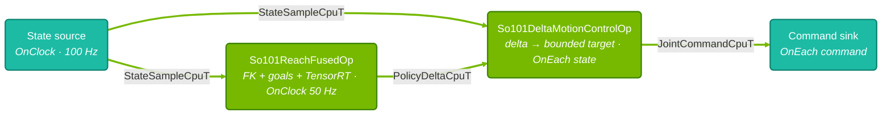

# SO-101 Reach Task

Moves the SO-101 fingertip through a grid of 3-D goals using a policy trained in
Isaac Lab. The policy produces four joint-position deltas at 50 Hz; the motion
controller bounds commands against measured joint positions at 100 Hz in mock and real modes.

- Positions are in radians; the Feetech driver converts encoder values.
- Wrist-roll and gripper stay at fixed positions. Gripper zero is calibrated closed.

| Mode | Executable | Behavior |
| --- | --- | --- |
| [`mock`](#mock) | `mock_so101_reach` | Constant state; validates inference and commands without moving a robot |
| [`real`](#real-hardware) | `so101_reach_real` | Reads and commands the arm through the Feetech bus |
| [`sim`](#isaac-sim) | `so101_reach_sim` | Receives simulated state and sends bounded position commands over UCX |

See [application modes](../../docs/explanation/application_modes.mdx) for clock and I/O differences.

## Run

Run from the repository root. All modes need a CUDA-capable GPU; the build downloads the
[policy model](#policy-model).

```bash
./isaac_os build so101_reach
./isaac_os modes so101_reach
```

TensorRT builds and caches the engine beside the ONNX on first use, keyed by GPU
and TensorRT version. No graph commands are issued during that build; real mode
homes the arm first.

<Tabs>

<Tab title="Mock" id="mock-run-tab">

### Mock

```bash
./isaac_os run so101_reach mock
```

The default run stops after 100 commands (about one second at 100 Hz), with a 30 s
timeout. Without CUDA it exits 77, which `test_mock_so101_reach` treats as skipped.
For a longer run:

```bash
./isaac_os run so101_reach mock --run-args='--message-count=6000 --completion-timeout-seconds=120'
```

Mock validates temporal contracts, inference and command bounds. Its constant
pose does not respond to commands, so it cannot validate reaching. Runs longer
than `policy.goal_hold_time` log expected goal timeouts.

</Tab>

<Tab title="Isaac Sim" id="isaac-sim-run-tab">

### Isaac Sim

Set up Isaac Sim 6.2.0.1 using the [Isaac Sim guide](../../docs/how-to/set_up_isaac_sim.mdx).

<Warning>

Isaac Sim up to 6.2.1.0 ignores PD gains (`kp` and `kd`) received through UCX.
Changing command gains does not change simulated stiffness or damping; tune the USD
articulation drives instead. See [joint-command gains](../../docs/how-to/set_up_isaac_sim.mdx#configure-joint-gains)
for details.

</Warning>

In one terminal, start the Reach layer of the SO-101 scene. The layer sets a 100 Hz physics step:

```bash
./isaac_sim run --scene operators/so101/assets/so101_reach_ucx_with_env.usda
```

Run the policy in a second terminal:

```bash
./isaac_os run so101_reach sim
```

The simulator starts playback on connection. Expect joint motion and logs of
reached goals or timeouts. Stop the application with Ctrl+C before stopping Sim.
Unlike mock mode, simulated positions respond to commands, so this mode exercises
the closed-loop reach path. The policy, controller and command bounds match real
mode. The scene uses the SO-101 SysID articulation drives, except that the Reach layer
raises the elbow drive damping to the shoulder pan joint's value; with the SysID value, the
policy drives a 2 Hz elbow oscillation. While `motion_control.motion_max_step_size` limits
each command to 0.05 rad from the measured position, the damped elbow settles near 0.2 rad/s
(drive stiffness × 0.05 rad ÷ damping, ignoring gravity), about a tenth of the real servo's
2.3 rad/s [speed limit](#servo-speed). Matching the real arm's PID
gains, speed profile and integral response still requires actuator validation.

Policy ticks, freshness checks and goal timers use wall time. Commands follow
received states, so a 100 Hz physics setting does not guarantee 100 Hz wall-time
commands, and playback faster or slower than real time changes the ratio of policy
ticks to physics steps. Steps more than 20 ms apart can cause policy ticks to skip;
slow runs can time out goals before reaching them. If received states are more than
`motion_control.target_expiry` (40 ms) apart, every policy delta is stale when the
next state arrives, so no commands are sent and the arm stays at its start pose.
When the application stops, it logs the joint states received and how many repeated
the previous physics step, the policy inferences run and skipped, and the commands sent
and policy targets that expired. It also warns if no fresh joint state arrived during
the last second before stopping.
Goals and fingertip FK use robot-base coordinates, independent of the scene's robot
placement.

TensorRT initializes before the simulator connection opens. Controller commands go
directly to UCX. The scene's command receive wait is bounded to 10 ms so physics can
advance when the policy skips a tick or a command expires; the articulation keeps its
last commanded target, matching real mode's no-command behavior. A command arriving
after this wait can be applied on a later physics step.

Isaac Sim 6.2.0.1 logs a receive-timeout warning for each tick without a command. The
warnings appear in the GUI console and in `kit/logs` under the launcher's cache root
(`~/docker/isaac-sim` by default), not in the launcher's terminal. Expect one at
connection, one at disconnection and an occasional one in between. A
warning on every tick after startup means states arrive too far apart for commands to be
sent; each of those ticks also waits the full 10 ms, which keeps the gap long. Start Sim
headless to shorten each step: add `--headless` after `--` in the launch command, or
unset `DISPLAY`.

Sim starts at the asset's pose; real mode first homes the arm. The scene publishes
unnamed six-joint arrays in `shoulder_pan`, `shoulder_lift`, `elbow_flex`,
`wrist_flex`, `wrist_roll`, `gripper` order; a custom scene must preserve this order,
and named arrays in a different order are rejected. The simulated joint limits
±110°, ±100°, ±96.8° and ±95° match `motion_control.joint_pos_limits_lower` and
`_upper`; the application's closed-form fingertip FK agrees with the simulated
fingertip to within 0.5 mm. The simulated asset's robot-base frame is the `baseframe`
prim, with robot-base +x along its -y axis. The asset authors joint friction and
armature only for the Newton physics engine, so the PhysX simulation runs without
them. The scene layer disables camera rendering and clock publication.

Compile the graph without a simulator or inference:

```bash
./isaac_os run so101_reach sim --run-args='--compile-only'
```

For a bounded live run, pass `--run-args='--message-count=1000'` to stop after
1,000 received joint states. To change the UCX host or port, copy the shared YAML,
edit `sim_so101`, and pass `--config-path` through `--run-args`. Match the simulator
launcher's `--port` to the YAML.

</Tab>

<Tab title="Real robot" id="real-hardware-run-tab">

### Real hardware

1. **Calibrate the follower arm** with [LeRobot](https://huggingface.co/docs/lerobot/so101). This
   application only consumes the JSON that guide produces; it cannot calibrate the arm.

   > **Note:** The file lands in
   > `~/.cache/huggingface/lerobot/calibration/robots/so_follower/<robot.id>.json`. The directory
   > is `so_follower`, not `so101_follower`: LeRobot 0.6.1 shares one calibration directory across
   > the SO-100 and SO-101 followers.

   Pose each arm joint at true mid-travel before pressing Enter, and hold the gripper half-open.
   During the subsequent range sweep, move the gripper through its full travel. The driver maps
   the calibrated closed endpoint to 0 rad regardless of motor direction, so a half-open
   calibration pose does not become the runtime zero. It clamps any `home_position` outside a
   joint's calibrated range and warns. Calibrate *before* running the application: torque stays
   enabled after exit, and a torqued joint cannot be hand-posed, so power-cycle the arm before
   recalibrating.

2. Grant your user serial-port access on the **host**:

   ```bash
   sudo setfacl -m u:$USER:rw /dev/ttyACM0
   ```

   > **Note:** The ACL does not survive a reboot or unplug/replug: `udev` recreates the node and
   > drops it. If the robot enumerates elsewhere (e.g. `/dev/ttyACM1`), adjust the path and
   > `real_robot.serial_port` to match.

3. **Copy the config.** This binary has no `--override`, and the `real_robot` keys are read
   straight from the YAML, so copy the file instead of editing the tracked one:

   ```bash
   cp applications/so101_reach/config/so101_reach_config.yaml build/so101-reach-real.yaml
   ```

4. **Point `real_robot.calibration_file` in the copy at the calibration JSON**, using an absolute
   path. `./isaac_os` sets `HOME=/workspace/isaac_os` inside the container, so `$HOME` there
   resolves to the repository rather than your home directory.

5. **Mount the calibration directory.** Host paths are not visible inside `./isaac_os` unless
   mounted. `$HOME` inside the `-v` flag is fine: the host shell expands both sides before Docker
   sees them.

   ```bash
   export ISAAC_OS_EXTRA_DOCKER_RUN_ARGS="$ISAAC_OS_EXTRA_DOCKER_RUN_ARGS -v $HOME/.cache/huggingface/lerobot:$HOME/.cache/huggingface/lerobot"
   ```

6. **Run the application** with the copied config. Keep the workspace clear: the
   arm first homes to `real_robot.home_position`, with `wrist_flex` at 1.5708 rad
   and the gripper closed. A cold TensorRT engine builds after homing while the
   arm holds that pose; missing or malformed ONNX errors also occur after homing.

   ```bash
   ./isaac_os run so101_reach real --run-args="--config-path=build/so101-reach-real.yaml"
   ```

The arm then follows the goal grid, logging reached goals and timeouts.
Stop with Ctrl+C to request a measured-position hold.

> **Warning:** Torque remains enabled after exit. Do not move joints by hand.
> Support the arm before disconnecting power. Shutdown disables integral gain,
> so the arm may settle slightly under load; the next start restores configured gains.

<details>
<summary>❓ What happens during initialization?</summary>

YAML validation and graph compilation happen before the serial port opens. The
driver then applies calibration, PID and gripper protection, enables torque and
homes the arm. TensorRT initialization follows when the graph starts.

</details>

</Tab>

</Tabs>

## Architecture

All modes share the policy and motion controller.
Mock and real modes use four operators. Sim replaces the state source with a UCX state
receiver and a state adapter, replaces the command sink with a UCX command sender, and
adds an operator that opens the simulator connection after startup.



- **State source:** `So101StateSourceOp` reads positions and velocities every
  `state_source.period`, with a monotonic `source_sequence` and a `fault_epoch`
  incremented on bus-read failure. `MockStateSourceOp` emits a constant pose at the same rate.
- **[Policy](../../operators/so101_reach/so101_reach_fused_op.h):** `So101ReachFusedOp`
  combines the goal grid, [fingertip FK](../../operators/so101_reach/so101_forward_kinematics.cc),
  20-D observation and TensorRT inference. It computes FK locally without publishing
  link poses. `OnClock` triggers it every `policy.inference_period`;
  `LatestWithin{inference_period}` with `Skip` skips inference on late or missing state.
- **[Motion controller](../../operators/so101/so101_delta_motion_control_op.h):**
  `So101DeltaMotionControlOp` runs `OnEach` state sample: 100 Hz in mock and real modes,
  the simulator's step rate in sim. It reads deltas with
  `LatestWithin{motion_control.target_expiry}` and `SafeDefault` on missing, holding and
  re-clamping the accepted target against fresh state on every tick.
- **Command sink:** `So101CommandSinkOp` writes servo positions and latches a
  present-position hold on cancellation, rejecting later commands. `stop()` requests
  the same idempotent hold. `MockCommandSinkOp` checks shape and finiteness, logs
  latency every tenth command and counts completed commands for `--message-count`.

Each operator has its own partition on `RealtimeClock`. In real mode, all four
edges use depth-one drop-oldest connections, avoiding state-source backpressure
and queued commands during shutdown.

### Staleness and fault handling

The controller drops its target and emits nothing if:

- `fault_epoch` changes;
- `source_sequence` regresses; or
- the target exceeds `motion_control.target_expiry`.

The servos then retain their last goal. An accepted delta must match the measured
fault epoch, reference a sequence no newer than the measured state, and be strictly
newer than the last accepted delta. There is no separate planner or watchdog.

### Observation vector (20-dim)

| Index | Content |
| ----- | ------- |
| 0-5 | Joint position relative to `policy.default_joint_position`. Slots 4-5 (wrist_roll, gripper) are forced to zero: both joints were held at their defaults during training |
| 6-8 | Fingertip position (xyz) from closed-form FK |
| 9-15 | Goal pose: position (xyz) plus orientation quaternion (wxyz), fixed at identity |
| 16-19 | Last action (the 4-D arm deltas, after clipping) |

The fused operator fixes this layout in code. At startup it requires float32
`obs` of shape `[1, 20]` and float32 `actions` of shape `[1, 4]`. Different
observation terms require a code change.

The policy omits joint velocity because the Feetech speed readings are too noisy for training.

### Action vector (4-dim)

Indices 0-3 are `shoulder_pan`, `shoulder_lift`, `elbow_flex`, and `wrist_flex`. Actions are
deltas against the measured joint position. The policy operator clips them, the controller bounds
the target it derives from them, and the controller bounds the emitted command again every tick:

```text
clipped = clip(action, -action_clip, +action_clip)                         # fused op, 50 Hz
target  = clamp(measured + clipped * action_scale,
                joint_pos_limits_lower, joint_pos_limits_upper)           # controller
target  = clamp(target, measured ± action_max_step_size)
command = clamp(target, measured ± motion_max_step_size)                  # every 100 Hz tick
```

Re-anchoring on `measured` means the per-tick bound holds even for a joint measured outside the
training articulation's range. Joints 4-5 are written from `motion_control.fixed_joint_positions`.
`JointCommandCpuT` also carries velocity, effort, kp, and kd arrays; the controller fills them
with zeros to preserve the message invariant, and the Feetech sink ignores them because the servos
are position-controlled.

### Goal sequence

`policy.goal_grid_n{x,y,z}` and the three `policy.goal_pos_*_range` pairs build a uniformly spaced
grid, iterated in Z/Y/X order - by default a 1×3×3 grid of nine goals in the y–z plane at
x = 0.20 m. A goal counts as reached once the fingertip stays within `policy.reach_threshold` for
`policy.goal_settle_time`; leaving the threshold before then cancels the settle. Outside the
threshold, `policy.goal_hold_time` is the per-goal budget, after which the operator logs a timeout
and advances. After the last goal the sequence wraps and logs how many goals were achieved.

## Configuration

Parameters live in [`config/so101_reach_config.yaml`](./config/so101_reach_config.yaml).

| Key | Default | Meaning |
| --- | --- | --- |
| `policy.onnx_path` | `data/grip_reach_delta_policy_onnx/policy_fingertip_delta.onnx` | Policy ONNX; TensorRT builds the engine on first run. |
| `policy.inference_period` | `0.02` | Policy tick period in seconds (50 Hz). |
| `policy.action_clip` | `1.0` | Symmetric clip applied to the raw policy output. |
| `policy.default_joint_position` | `[0, 0, 0, 1.57, 0, 0]` | Training defaults subtracted for `joint_pos_rel`. |
| `policy.goal_pos_x/y/z_range` | `[0.20, 0.20]`, `[-0.112, 0.112]`, `[0.136, 0.264]` | Goal grid extent in meters; keep it within the training command ranges. |
| `policy.goal_grid_nx/ny/nz` | `1` / `3` / `3` | Goals per axis; at most 100 per axis. |
| `policy.goal_hold_time` | `10.0` | Seconds before an unreached goal times out. |
| `policy.goal_settle_time` | `1.0` | Seconds within tolerance before a goal counts as reached. |
| `policy.reach_threshold` | `0.05` | Fingertip-to-goal tolerance in meters. |
| `state_source.period` | `0.01` | Joint-state period in seconds (100 Hz). |
| `motion_control.action_scale` | `0.2` | Radians per unit of clipped policy output. |
| `motion_control.action_max_step_size` | `0.1` | Bound on a new target vs. measured position, in radians; set it to the `max_step_size` the policy trained with. |
| `motion_control.motion_max_step_size` | `0.05` | Per-tick bound on the emitted command vs. measured position. |
| `motion_control.target_expiry` | `0.04` | Seconds before the held target is discarded (two policy periods). |
| `motion_control.fixed_joint_positions` | `[0.0, 0.0]` | Held wrist_roll and gripper positions. |
| `motion_control.joint_pos_limits_lower` / `_upper` | ±1.92, ±1.75, ±1.69, ±1.66 | Per-joint limits for the four actuated joints. |
| `real_robot.serial_port` | `/dev/ttyACM0` | Feetech USB serial device. |
| `real_robot.calibration_file` | placeholder JSON path | LeRobot follower calibration; a placeholder is rejected at startup. |
| `real_robot.position_p_gain` / `_i_gain` / `_d_gain` | `16` / `16` / `32` | Servo PID registers; see the hardware notes for why **I = 16**. |
| `real_robot.run_speed` / `run_acceleration` | `1500` / `60` | Servo motion profile. |
| `real_robot.home_position` | `[0.0, 0.0, 0.0, 1.5708, 0.0, 0.0]` | Homing pose written before the graph runs; gripper zero is calibrated closed. |
| `sim_so101.hostname` | `127.0.0.1` | Isaac Sim UCX listener host for `sim`. |
| `sim_so101.port` | `50008` | Isaac Sim UCX listener port; must match the simulator launcher's `--port`. |

The `real_robot` block matches [`so101_sinus_motion`](../so101_sinus_motion/README.md)
and is read straight from the YAML before the graph compiles.

## Policy model

The build downloads the delta policy from
[`nvidia/so101-reach`](https://huggingface.co/nvidia/so101-reach) on Hugging Face. Training,
I/O contract, and license terms can be found on HF.

To run your own policy, set `policy.onnx_path` to a file outside
`data/grip_reach_delta_policy_onnx/`, which the build overwrites.

> **Policy contract:** Use a policy trained for joint-position deltas. Tensor-shape validation
> does not check the action law; a shape-compatible absolute-action policy would produce
> incorrect commands under this delta controller.

## Command-line options

| Option | Modes | Default |
| --- | --- | --- |
| `--config-path` | mock, real, sim | `applications/so101_reach/config/so101_reach_config.yaml` |
| `--message-count` | mock, real | `100` in mock; unlimited in real |
| `--completion-timeout-seconds` | mock | `30` |
| `--message-count` | sim | Unlimited; counts received joint states |
| `--compile-only` | sim | Off; compile the graph without connecting or running inference |

## Tests

```bash
./isaac_os test so101_reach
```

This covers config decoding, the bounded mock graph, simulation boundary checks
and simulation graph compilation. The operators test FK, the fixed observation,
goal grid and delta control law. Graph compilation does not establish reach convergence.

## Benchmark capture

See [Profile an Application](../../docs/how-to/profile_an_application.mdx) for source-to-sink and
path-level statistics from an Nsight Systems capture of these binaries.

## Hardware notes

### Servo gains

<details>
<summary>❓ Why does reach use integral gain?</summary>

The servo position loop uses `real_robot.position_p_gain`, `_i_gain` and `_d_gain`.
With `measured + delta` commands, the scaled, clamped delta is the servo's position
error. At LeRobot's default `I = 0`, gravity-loaded joints can stall: re-anchoring
each command to measured position prevents the error from accumulating.
`shoulder_pan` may track while `shoulder_lift` and `elbow_flex` barely move.

Reach therefore uses `position_i_gain: 16`. Raise it gradually; integral wind-up
causes overshoot around a held target.

</details>

### Servo speed

`real_robot.run_speed` is in encoder steps/s, at π/2048 rad per step. The default
1500 limits speed to about 2.3 rad/s. Both command bounds
(`action_max_step_size / inference_period` and `motion_max_step_size / state_source.period`)
allow 5 rad/s at their defaults, so servo speed limits motion first. Keep the two command
bounds consistent: a safety limiter tighter than the policy's trained step reshapes normal
motion instead of only catching faults.

### Shutdown

<details>
<summary>❓ How does the hold prevent further motion?</summary>

Closing the serial port alone would leave the servos driving toward their last
`measured + delta` target. Ctrl+C and runtime exceptions request a measured-position
hold; the driver then rejects later motion commands.

The hold sets integral gain to zero while retaining P/D gains and torque, preventing
delayed integral corrections.

</details>
