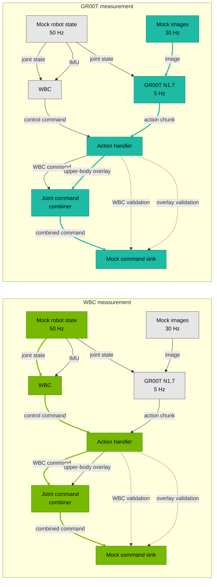

{/*
SPDX-FileCopyrightText: Copyright (c) 2026 NVIDIA CORPORATION & AFFILIATES. All rights reserved.
SPDX-License-Identifier: Apache-2.0
*/}

{/* Generated from an application BENCHMARK.md by docs/scripts/sync_application_pages.py. */}

# Benchmark

This benchmark measures software latency and command timing when whole-body control (WBC)
and GR00T N1.7 run together on AGX Thor, comparing shared GPU execution with CUDA Green
Context isolation for WBC. Latency is measured from the source callback start to the command
sink callback end along two paths:

- **WBC (green):** joint state through the WBC inference operator to the combined joint
  command at 50 Hz.
- **GR00T image-to-command (teal):** image through the GR00T inference operator to its first
  trace-visible combined joint command, with 5 Hz inference selecting from 30 Hz mock images.

The diagrams highlight each measured path; dotted connections carry validation inputs.
Mock inputs and outputs exclude physical camera latency, robot communication, and actuator response.



## Results

<Accordion title="Jetson AGX Thor Benchmark Configuration">

- **Run date:** October 28–29, 2026 (UTC), one one-hour trial per Green Context condition on AGX Thor.
- **Platform:** NVIDIA Jetson AGX Thor Developer Kit; NVIDIA driver 595.78;
  PREEMPT_RT kernel `6.8.12-1021-rt-tegra`. The Jetson Linux package version was not recorded.
- **Isaac OS commit:** `3c3ca720ee5ecd6f47833e44489d7a461ada4030` (internal mirror).
- **Tools:** CUDA 13.2, TensorRT 10.16.0.72, Nsight Systems 2026.4.1.
- **Container image ID:** `sha256:14a7a8df08533ed3e1906b5fe53f564348484f3e32f25252b2b497f8c43606bc`.
- **Holoscan SDK:** prebuilt 5.0.0 from `nvcr.io/nvidia/clara-holoscan/holoscan:v5.0.0-cuda13`.
- **Configuration:** `config/control.yaml` and `operators/gr00t_n1_7/config/n1_7_g1.yaml`
  at the Isaac OS commit above; five GR00T model engines initialized before timed trials.
- **WBC SM allocation:** off: 0 (shared GPU); on: 2 of Thor's 20 SMs, leaving 18 for the residual graph.
- **Host settings:** reference 120W power mode (mode 1); CPU 2.601 GHz, GPU GPC 1.386 GHz,
  GPU NVD 1.557 GHz and EMC 4.266 GHz locked; display manager inactive; CPU deep idle disabled.
  The shared host preflight passed before and after each capture.
- **RT CPU budget:** `kernel.sched_rt_runtime_us=-1` (RT bandwidth throttling disabled).
  Timer migration was disabled with `kernel.timer_migration=0`.
- **Scheduling:** CPUs 8–13 isolated; default IRQ, unbound workqueue and kernel-thread
  affinity CPUs 0–7. Controller pinned to CPU 1, background operators to CPU 0,
  GR00T to CPU 12 (`SCHED_FIFO` priority 5), and WBC to CPU 13 (`SCHED_FIFO` priority 10).
  Worker affinity and scheduling were verified during each capture.
  Tickless operation and RCU offload were not enabled.
- **Measurement:** source callback start to sink callback end; a common 20-second warmup
  and 3,600-second source window for both paths. Each capture stops after 181,100 joint commands.
- **GR00T scope:** first trace-visible final command for each matched image. Retained action
  state and fan-in do not establish an image's contribution to later commands or action playback.
- **Measurement order:** one trial with Green Context off, then one with it on.
  All statistics describe the single trial for each condition.

</Accordion>

WBC p99.9 latency was **2.5747 ms with Green Context off** and
**0.3747 ms with Green Context on** while GR00T ran concurrently.
With Green Context on, WBC p50 was **0.2794 ms**; GR00T image-to-command
latency was **120.2659 ms at p50** and **140.2846 ms at p99.9**.
No measured response exceeded the 20 ms WBC or 200 ms GR00T latency budget.
Each condition was measured once for one hour.

GR00T commands are forwarded on the 50 Hz WBC update cycle. A result that misses
one update waits for the next, which can add about 20 ms to image-to-command latency.
In these captures, Green Context reduced WBC tail latency. GR00T image-to-command
latency had a lower median but a higher p99.9. These measurements do not establish
the cause of differences between machines.

### WBC results

| Metric | Green Context off | Green Context on |
| --- | ---: | ---: |
| Measured samples | 180,001 | 180,001 |
| Latency p50 | 0.2560 ms | 0.2794 ms |
| Latency p99.9 | 2.5747 ms | 0.3747 ms |
| Sink completion rate | 50.0 Hz | 50.0 Hz |
| Responses over 20 ms | 0 | 0 |

### GR00T image-to-command results

| Metric | Green Context off | Green Context on |
| --- | ---: | ---: |
| Measured samples | 18,000 | 18,000 |
| Latency p50 | 126.9310 ms | 120.2659 ms |
| Latency p99.9 | 126.9618 ms | 140.2846 ms |
| Sink completion rate | 5.0 Hz | 5.0 Hz |
| Responses over 200 ms | 0 | 0 |

<Accordion title="Full Results">

All statistics describe one one-hour trial per condition. Green Context off was
measured first, followed by Green Context on; there are no repeated trials.

### WBC statistics

| Metric | Green Context off | Green Context on |
| --- | ---: | ---: |
| Latency mean | 0.2487 ms | 0.2560 ms |
| Latency minimum | 0.0978 ms | 0.1001 ms |
| Latency p50 | 0.2560 ms | 0.2794 ms |
| Latency p90 | 0.3121 ms | 0.3107 ms |
| Latency p99 | 0.5163 ms | 0.3197 ms |
| Latency p99.9 | 2.5747 ms | 0.3747 ms |
| Latency maximum | 6.4768 ms | 0.5130 ms |
| Latency standard deviation | 0.1497 ms | 0.0506 ms |
| Sink period error p99.9 | 3.0039 ms | 0.2292 ms |
| Source callback rate | 50.0000 Hz | 50.0000 Hz |
| Emit rate | 50.0000 Hz | 50.0000 Hz |
| Sink completion rate | 50.0000 Hz | 50.0000 Hz |

### GR00T image-to-command statistics

| Metric | Green Context off | Green Context on |
| --- | ---: | ---: |
| Latency mean | 126.9216 ms | 120.9890 ms |
| Latency minimum | 123.6629 ms | 116.9553 ms |
| Latency p50 | 126.9310 ms | 120.2659 ms |
| Latency p90 | 126.9468 ms | 120.2834 ms |
| Latency p99 | 126.9553 ms | 140.2681 ms |
| Latency p99.9 | 126.9618 ms | 140.2846 ms |
| Latency maximum | 146.9024 ms | 140.2948 ms |
| Latency standard deviation | 0.2215 ms | 3.7314 ms |
| Sink period error p99.9 | 0.1321 ms | 20.0133 ms |
| Source callback rate | 30.0000 Hz | 30.0000 Hz |
| Emit rate | 30.0000 Hz | 30.0000 Hz |
| Sink completion rate | 5.0000 Hz | 5.0000 Hz |

Each trial uses the same one-hour source window after a 20-second warmup. Eligible
images arrive at 30 Hz, while GR00T selects images for inference at 5 Hz. Unmatched
images have no trace-visible response on this exact path; they do not prove a transport drop.
Matched / selected counts refer to first responses. Counts are not pooled across paths.

| Path / condition | Trial | Eligible | Matched / selected | Unmatched | p50 (ms) | p99.9 (ms) | Max (ms) | Over budget |
| --- | ---: | ---: | ---: | ---: | ---: | ---: | ---: | ---: |
| WBC off | 1 | 180,001 | 180,001 | 0 | 0.2560 | 2.5747 | 6.4768 | 0 |
| WBC on | 1 | 180,001 | 180,001 | 0 | 0.2794 | 0.3747 | 0.5130 | 0 |
| GR00T off | 1 | 108,001 | 18,000 | 90,001 | 126.9310 | 126.9618 | 146.9024 | 0 |
| GR00T on | 1 | 108,001 | 18,000 | 90,001 | 120.2659 | 140.2846 | 140.2948 | 0 |

</Accordion>

## Run the benchmark

<Info>
Before benchmarking, check your AGX Thor host for settings that may limit performance.
Run this command on the host from the repository root:

```bash
python3 tools/host_preflight.py
```

Follow [Optimize your host](/isaac-os/how-to/optimize-your-host#check-your-configuration)
for setup guidance. Use the host settings above to reproduce these results.
</Info>

See [Profile an Application](/isaac-os/how-to/profile-an-application)
for profiling and report options.

### Build and capture

Set `WBC_SMS=2` for Green Context on, or `0` for off. The unprofiled 500-command run
initializes the models before capture. Verify the SM allocation in the application log.

```bash
./isaac_os build gr00t_n1_7_wbc_g1

WBC_SMS=2
TRIAL=1
OUT="build/benchmarks/gr00t/thor/wbc-sms-$WBC_SMS/trial-$TRIAL"
mkdir -p "$OUT"

./isaac_os run gr00t_n1_7_wbc_g1 mock --no-local-build --no-docker-build \
  -- --benchmark-controller-core=1 --benchmark-background-core=0 \
  --benchmark-gr00t-core=12 --benchmark-wbc-core=13 \
  --green-context-wbc-sms="$WBC_SMS" --message-count=500 > "$OUT/readiness.log" 2>&1

./isaac_os run gr00t_n1_7_wbc_g1 mock --no-local-build --no-docker-build \
  --nsys-args="--trace=nvtx --sample=none --backtrace=none --cpuctxsw=none --force-overwrite=true -o /workspace/isaac_os/$OUT/profile" \
  -- --benchmark-controller-core=1 --benchmark-background-core=0 \
  --benchmark-gr00t-core=12 --benchmark-wbc-core=13 \
  --green-context-wbc-sms="$WBC_SMS" --message-count=181100 > "$OUT/application.log" 2>&1
```

The 181,100 final joint commands allow a 20-second warmup, one-hour measurement window
and about 2 seconds for trailing responses at 50 Hz. Run once with Green Context off
and once with it on, using the same build and host settings. Keep a separate output
directory for each condition; no repeated trials are needed.

### Analyze

From the same host shell, open the capture directory in the app container:

```bash
./isaac_os run-container gr00t_n1_7_wbc_g1 mock --no-docker-build -- \
  "cd /workspace/isaac_os/$OUT && exec bash"
```

Run all remaining commands in this container shell: export the capture, then generate
the WBC and GR00T reports below.

```bash
nsys export --type sqlite --include-blobs=true --force-overwrite=true \
  -o profile.sqlite profile.nsys-rep
```

#### WBC path

Select the joint-state-to-command path with a 20 ms period and latency budget:

```bash
cat > wbc-path.txt <<'EOF'
mock_joint_state_source.out_wbc_joint_state -> agile_wbc.in_joint_state -> agile_wbc.out_joint_command -> gr00t_action_handler.in_control_command -> gr00t_action_handler.out_control_command -> joint_command_combiner.in_primary_joint_command -> joint_command_combiner.out_joint_command -> mock_joint_command_sink.in_joint_command
EOF

nsys stats --report-dir /workspace/isaac_os/tools/profiling \
  --report 'data_flow_tracking:port-path-file=wbc-path.txt:responses=first:window-unit=ns:warmup=20000000000:window=3600000000000:expected-period-ns=20000000:latency-budget-ns=20000000' \
  --format json --timeunit msec --force-overwrite=true --output wbc \
  profile.sqlite 2> wbc-report.stderr
```

#### GR00T image-to-command path

Select the image-to-first-command path with a 200 ms period and latency budget:

```bash
cat > image-path.txt <<'EOF'
mock_image_source.out_image -> gr00t_n1_7.in_image -> gr00t_n1_7.out_action_chunk -> gr00t_action_handler.in_action_chunk -> gr00t_action_handler.out_action_command -> joint_command_combiner.in_overlay_joint_command -> joint_command_combiner.out_joint_command -> mock_joint_command_sink.in_joint_command
EOF

nsys stats --report-dir /workspace/isaac_os/tools/profiling \
  --report 'data_flow_tracking:port-path-file=image-path.txt:responses=first:window-unit=ns:warmup=20000000000:window=3600000000000:expected-period-ns=200000000:latency-budget-ns=200000000' \
  --format json --timeunit msec --force-overwrite=true --output image \
  profile.sqlite 2> image-report.stderr
```

Expect about 180,000 matched WBC messages and 18,000 matched images in each one-hour
window. About 108,000 images are eligible at 30 Hz; unmatched images have no visible
response on this exact path because inference selects images at 5 Hz.
