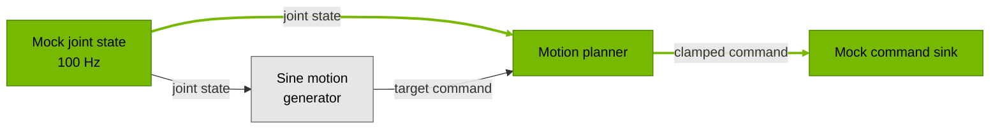

{/*
SPDX-FileCopyrightText: Copyright (c) 2026 NVIDIA CORPORATION & AFFILIATES. All rights reserved.
SPDX-License-Identifier: Apache-2.0
*/}

{/* Generated from an application BENCHMARK.md by docs/scripts/sync_application_pages.py. */}

# Benchmark

This benchmark measures software latency and command timing in the SO-101 sinus-motion
application on AGX Thor, using mock joint states at 100 Hz. Latency is measured from the
state source callback start to the command sink callback end. The run instructions select
the direct state source → motion planner → command sink path, highlighted below.
The sine generator supplies the planner's latest target; this metric measures the
response to incoming state and excludes target generation and target age.
Results cover typical and tail latency, message rates, and command-period error;
mock inputs and outputs exclude robot communication and physical actuator response.



## Results

<Accordion title="Jetson AGX Thor Benchmark Configuration">

- **Run date:** October 14, 2026 (UTC), one one-hour trial on AGX Thor.
- **Platform:** NVIDIA Jetson AGX Thor Developer Kit; Jetson Linux R39.2.1
  (`nvidia-l4t-core` 39.2.1-20260806224157), NVIDIA driver 595.78;
  PREEMPT_RT kernel `6.8.12-1021-rt-tegra`.
- **Isaac OS commit:** `fba280c50b89cf2cbbbac3fa62ea470bd5ba2480` (internal mirror).
- **Tools:** CUDA 13.2.51, TensorRT 10.16.0.72, Nsight Systems 2026.2.1.210.
- **Container image ID:** `sha256:72fda6a18147bfa7ada7478141aaf1e619338a19df1dfbbab8c3f617f30788c3`.
- **Holoscan SDK commit:** `9be029084c7c0d5fbce67e7eed42d5319f5942dc` (5.0.0).
- **Host settings:** 120 W power mode (mode 1); CPU 2.601 GHz, GPU GPC 1.386 GHz,
  GPU NVD 1.557 GHz and EMC 4.266 GHz locked; display manager inactive.
- **RT CPU budget:** `kernel.sched_rt_runtime_us=-1` (RT bandwidth throttling disabled).
- **Scheduling:** CPUs 8–13 isolated; housekeeping/IRQ CPUs 0–7. No explicit
  application CPU affinity. The `nohz_full` and `rcu_nocbs` boot options are set,
  but the running kernel lacks `CONFIG_NO_HZ_FULL` and `CONFIG_RCU_NOCB_CPU`;
  tickless operation and RCU offload are not enabled.
- **Measured path:** state source → motion planner → command sink.
- **Measurement:** one trial, excluding 1,000 warmup messages and measuring the
  next 360,000 (one hour at 100 Hz). All statistics describe this single trial.

</Accordion>

Latency was **0.0271 ms at p50** and **0.0993 ms at p99.9**.
The one-hour trial contained **360,000** eligible, matched and selected responses,
with **zero** unmatched sources, responses over the **10 ms** budget or trace-health warnings.

| Metric | Result |
| --- | ---: |
| Measured samples | 360,000 |
| Latency p50 | 0.0271 ms |
| Latency p99.9 | 0.0993 ms |
| Sink completion rate | 100.0 Hz |
| Responses over 10 ms | 0 |

<Accordion title="Full Results">

All statistics describe the single one-hour trial. Source counts and latency-budget
exceedances refer to the direct state-to-command path.

| Metric | Result |
| --- | ---: |
| Latency mean | 0.0288 ms |
| Latency minimum | 0.0141 ms |
| Latency p50 | 0.0271 ms |
| Latency p90 | 0.0356 ms |
| Latency p99 | 0.0545 ms |
| Latency p99.9 | 0.0993 ms |
| Latency maximum | 0.7462 ms |
| Latency standard deviation | 0.0105 ms |
| Sink period error p99.9 | 0.2646 ms |
| Source callback rate | 100.0000 Hz |
| Emit rate | 100.0000 Hz |
| Sink completion rate | 100.0000 Hz |

| Path / condition | Trial | Eligible | Matched / selected | Unmatched | p50 (ms) | p99.9 (ms) | Max (ms) | Over budget |
| --- | ---: | ---: | ---: | ---: | ---: | ---: | ---: | ---: |
| SO-101 | 1 | 360,000 | 360,000 | 0 | 0.0271 | 0.0993 | 0.7462 | 0 |

</Accordion>

## Run the benchmark

<Info>
Before benchmarking, check your AGX Thor host for settings that may limit performance.
Run this command on the host from the repository root:

```bash
python3 tools/host_preflight.py
```

Follow [Optimize your host](/isaac-os/how-to/optimize-your-host#check-your-configuration)
to resolve any warnings before capturing results.
</Info>

See [Profile an Application](/isaac-os/how-to/profile-an-application)
for profiling and report options.

### Build and capture

Capture the full mock graph; analysis selects the highlighted direct state-to-command path.

```bash
./isaac_os build so101_sinus_motion

TRIAL=1
OUT="build/benchmarks/so101/thor/trial-$TRIAL"
mkdir -p "$OUT"

./isaac_os run so101_sinus_motion mock --no-local-build --no-docker-build \
  --nsys-args="--trace=nvtx --sample=none --backtrace=none --cpuctxsw=none --force-overwrite=true -o /workspace/isaac_os/$OUT/profile" \
  -- --message-count=361100 > "$OUT/application.log" 2>&1
```

The 361,100 final commands cover 1,000 warmup messages (10 seconds), 360,000 measured
messages (one hour at 100 Hz), and 100 trailing commands. Run one trial with these settings.

### Analyze

From the same host shell, open the capture directory in the app container:

```bash
./isaac_os run-container so101_sinus_motion mock --no-docker-build -- \
  "cd /workspace/isaac_os/$OUT && exec bash"
```

Run these commands inside the container. They select the direct state source → planner → sink
path, skip 1,000 warmup messages and measure the next 360,000.

```bash
nsys export --type sqlite --include-blobs=true --force-overwrite=true \
  -o profile.sqlite profile.nsys-rep

cat > command-path.txt <<'EOF'
mock_state_source.out_state -> motion_planner.in_state -> motion_planner.out_command -> mock_command_sink.in_command
EOF

nsys stats --report-dir /workspace/isaac_os/tools/profiling \
  --report 'data_flow_tracking:port-path-file=command-path.txt:responses=first:warmup=1000:window=360000:expected-period-ns=10000000:latency-budget-ns=10000000' \
  --format json --timeunit msec --force-overwrite=true --output command \
  profile.sqlite 2> command-report.stderr
```
