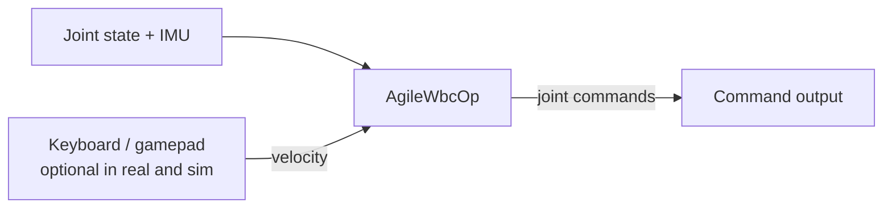

{/*
SPDX-FileCopyrightText: Copyright (c) 2026 NVIDIA CORPORATION & AFFILIATES. All rights reserved.
SPDX-License-Identifier: Apache-2.0
*/}

{/* Generated from an application README by docs/scripts/sync_application_pages.py. */}

# Unitree G1 WBC

Runs Agile whole-body control on the Unitree G1 with Holoscan SDK 5.
For camera-driven arm and hand control, use [GR00T + WBC](/isaac-os/reference/applications/gr00t-n1-7-wbc-g1).

| Mode | Executable | Purpose |
| --- | --- | --- |
| [`mock`](#mock) (default) | `mock_wbc_g1` | Deterministic inputs without a robot or simulator |
| [`sim`](#isaac-sim) | `sim_ucx_wbc_g1` | Isaac Sim over UCX with simulation time |
| [`real`](#real-robot) | `unitree_g1_wbc` | Physical G1 over DDS; deployment instructions incomplete |
| [`unitree_sim`](#unitree-mujoco) | `unitree_g1_wbc` | Unitree MuJoCo over DDS domain 1; run procedure not documented |

See [application modes](/isaac-os/explanation/application-modes) for clock and I/O differences.

## Architecture

Real, Isaac Sim, and mock modes share the same WBC control path. `AgileWbcOp` consumes
joint state and IMU samples with matching capture timestamps and produces joint commands.
Optional keyboard/gamepad input supplies locomotion velocity in real and Isaac Sim modes.



> **Note:** `StartUpOp` is not shown. Real mode connects WBC → `StartUpOp` → DDS publisher;
> the startup operator also receives measured joint state and handles waypoints and enable gating.
> Sim and mock connect WBC directly to their command output without a startup operator.

| Responsibility | Real | Isaac Sim (`sim`) | Mock |
| --- | --- | --- | --- |
| Entry point | real/main.cc (`applications/wbc_g1/real/main.cc`) | sim/main.cc (`applications/wbc_g1/sim/main.cc`) | mock/main.cc (`applications/wbc_g1/mock/main.cc`) |
| State and IMU | DDS subscriber | UCX interface with paired sensor samples | Deterministic state and IMU source |
| Command output | DDS publisher | UCX sender | Validation sink |
| Startup processing | `StartUpOp` between WBC and publisher; measured-pose input, waypoints and enable gate | WBC active from the first tick; no `StartUpOp` | No startup gate |
| Clock | Wall time | Simulator-driven synthetic time | Wall time |

## Run

Run from the repository root on a CUDA-capable system:

```bash
./isaac_os build wbc_g1
```

Choose one mode and launch one controller. In real and Isaac Sim modes, add `--gamepad`
to enable keyboard/gamepad input; a keyboard connected to the app host is sufficient.
Complete [device setup](/isaac-os/reference/applications/gr00t-n1-7-wbc-g1#device-setup) before launching with
that flag, then use the shared [controls](/isaac-os/reference/applications/gr00t-n1-7-wbc-g1#controls).
Without `--gamepad`, WBC uses the configured static locomotion velocity (zero by default).

<Tabs>

<Tab title="Mock" id="mock-run-tab">

### Mock

Deterministic 50 Hz joint state and IMU feed `AgileWbcOp` with the configured static
velocity command. The sink checks each command's size, finite values and nonzero
content.

```bash
./isaac_os run wbc_g1 mock
```

Stop the default run with Ctrl+C. Use `--message-count` for a short validation run:

```bash
./isaac_os run wbc_g1 mock -- --message-count=4
```

</Tab>

<Tab title="Isaac Sim" id="isaac-sim-run-tab">

### Isaac Sim

#### Requirements

Set up [Isaac Sim](/isaac-os/how-to/set-up-isaac-sim). The scene needs network
access for online assets; TensorRT engine creation can take several minutes.

Simulator and controller run on x86_64 and use port `50008`.

<Warning>

Isaac Sim up to 6.2.1.0 ignores PD gains (`kp` and `kd`) received through UCX.
Changing command gains does not change simulated stiffness or damping; tune the USD
articulation drives instead. See [joint-command gains](/isaac-os/how-to/set-up-isaac-sim#configure-joint-gains)
for details.

</Warning>

Start the simulator in terminal 1:

```bash
./isaac_sim run -y --scene operators/unitree_g1/assets/g1_ucx.usda \
  -- --substeps 4
```

Start terminal 2:

```bash
./isaac_os run wbc_g1 sim
```

To enable keyboard/gamepad velocity control instead, run:

```bash
./isaac_os run wbc_g1 sim -- --gamepad
```

The controller loads the Agile WBC TensorRT engine, then simulation starts.
With no input, expect the G1 to maintain its standing balance at zero commanded velocity.

Startup is automatic in Isaac Sim; no startup-enable button is needed. Once the robot
is balancing, use the shared [controls](/isaac-os/reference/applications/gr00t-n1-7-wbc-g1#controls) if
`--gamepad` is enabled.

#### Camera display and shutdown

<details>
<summary>📄 Startup log messages</summary>

The controller reports `Connected to the UCX peer at 127.0.0.1:50008.`.
The simulator reports `UCX client connected - starting simulation.`.

</details>

To display the simulator camera in a separate window, use:

```bash
./isaac_os run wbc_g1 sim -- --holoviz
```

Holoviz is optional, requires a display, and does not enable camera publication in the scene.
It can be combined with `--gamepad`.

Stop the controller with Ctrl+C first. The simulator resets its stage and waits for another
connection. Restart the controller for another run, or stop the simulator with Ctrl+C
when finished. Run only one controller per simulator endpoint.

</Tab>

<Tab title="Real robot" id="real-robot-run-tab">

### Real robot

> **Warning:** The command below assumes a prepared robot. This page does not cover
> robot preparation or the physical stopping procedure.

Set `unitree_g1_robot.network_interface` in
config/wbc_g1_config.yaml (`applications/wbc_g1/config/wbc_g1_config.yaml`) to the robot-facing interface
before launching (list interfaces with `ip -brief link`). The run mode loads this YAML
automatically; its DDS domain defaults to 0.

```bash
./isaac_os run wbc_g1 real -- --gamepad
```

The startup routine runs first;
see the shared [controls](/isaac-os/reference/applications/gr00t-n1-7-wbc-g1#controls) for lower- and upper-body
enables and locomotion inputs. With `--gamepad`, startup waits
for enable inputs; the automatic timeout does not apply. Press Ctrl+C to stop the app process;
this is not a documented physical robot stopping procedure.

Without `--gamepad`, startup releases automatically after the configured
`start_up.auto_enable_delay` (60 seconds at the final pose by default), and WBC uses the
configured static velocity.

</Tab>

<Tab title="Unitree MuJoCo" id="unitree-mujoco-run-tab">

### Unitree MuJoCo

The `unitree_sim` mode uses DDS domain 1 and
`config/wbc_g1_sim_config.yaml` (`applications/wbc_g1/config/wbc_g1_sim_config.yaml`) for the 29-joint
simulator. Its run procedure is not documented here.

</Tab>

</Tabs>

## Simulation configuration

sim/main.cc (`applications/wbc_g1/sim/main.cc`) uses the shared
UCX interface subgraph (`operators/unitree_sim_ucx/unitree_sim_ucx_subgraph.h`), also used by
N1.7 + WBC, for transport, clock advancement, and `UnitreeSimStateOp`. The adapter publishes IMU
before matching joint state; depth-two, drop-oldest input queues bound pending history. Both
sensors must carry the same capture timestamp for each control step. A missing or mismatched
partner produces no control update. The app connects the paired outputs to `AgileWbcOp` and its
commands to the UCX sender, keeping all three on the control partition.

Without `--holoviz`, `MessageDropSinkOp` drains camera messages directly from the image receiver.
With `--holoviz`, RGB camera images feed HoloViz directly in a separate visualization partition,
using a depth-one drop-oldest connection. Visualization does not feed the control loop.

Physics runs at 200 Hz and control at 50 Hz with `--substeps 4`. Sensor capture
timestamps are preserved. The connection opens after all operators finish startup,
so models initialize before simulation begins.

The run mode loads config/wbc_g1_sim_ucx_config.yaml (`applications/wbc_g1/config/wbc_g1_sim_ucx_config.yaml`).
This launcher reads `gr00t_wbc` and, with `--gamepad`, `gamepad`; the other sections in that
file are not used by this launcher. Static motion commands are
`velocity_command_lin_x`, `velocity_command_lin_y`, and `velocity_command_ang_z`.
With `--gamepad`, the top-level `gamepad` section selects devices, speeds, and mappings.
Teleop polls every `gamepad.emit_period` simulation seconds on its own partition, and WBC
selects the latest velocity without waiting for input. Without `--gamepad`, the configured
static velocities remain in effect. See the shared [controls](/isaac-os/reference/applications/gr00t-n1-7-wbc-g1#controls).

| Option | Default / purpose |
| --- | --- |
| `--hostname` | `127.0.0.1`; simulator host |
| `--port` | `50008`; must match simulator |
| `--config-path` | WBC configuration selected by the run mode |
| `--compile-only` | Compile the graph without connecting or running operators; CUDA is still required |
| `--gamepad` | Enable keyboard/gamepad velocity input; off by default |
| `--holoviz` | Display the simulator camera in a 640 by 480 window; off by default |

For another port, change both ends:

```bash
./isaac_sim run -y --scene operators/unitree_g1/assets/g1_ucx.usda \
  -- --substeps 4 --port 50019
./isaac_os run wbc_g1 sim -- --port 50019
```

Run those commands in separate terminals. Add `--hostname <sim-host>` to the controller
for a remote simulator.

## Simulation troubleshooting

<details>
<summary>⚠️ Connection, motion and resource problems</summary>

- Connection failure: check simulator readiness, matching ports, and whether another controller
  already owns the endpoint. Restart the app after the simulator is ready.
- Unexpected motion: confirm the scene, `--substeps 4`, joint order, scene-authored drive gains,
  and velocity command.
  Mock-test success alone does not validate physical behavior in simulation.
- Runtime failure or repeated scene resets: inspect both logs. The simulator resets after a
  controller disconnect or a simulation-step error; the logs identify which occurred.
- Missing resources: allow model downloads and engine creation to finish. When reusing build
  directories across worktrees, preserve their configured shared-cache mounts.

</details>

## Benchmark capture

See [Profile an Application](/isaac-os/how-to/profile-an-application) to measure this
application with its native trace markers.

Current WBC-under-GR00T measurements are in the
[benchmark results](/isaac-os/reference/applications/gr00t-n1-7-wbc-g1/benchmark#results).
