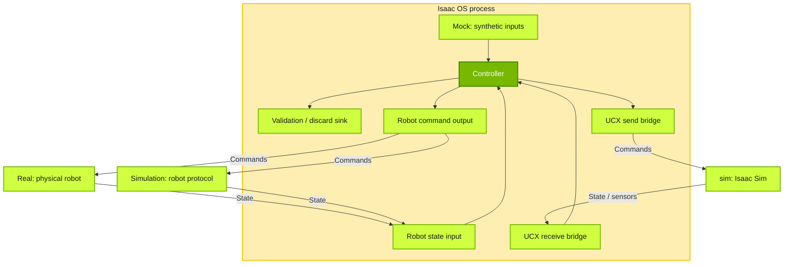
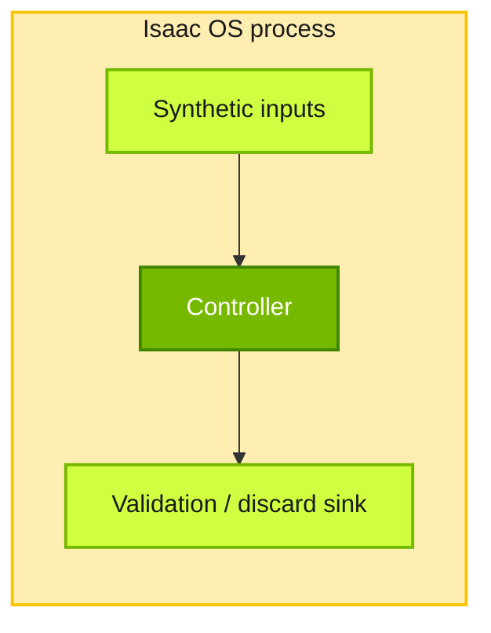
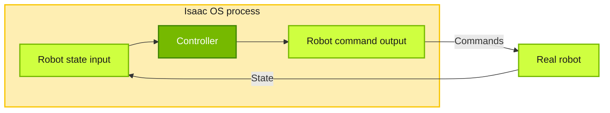
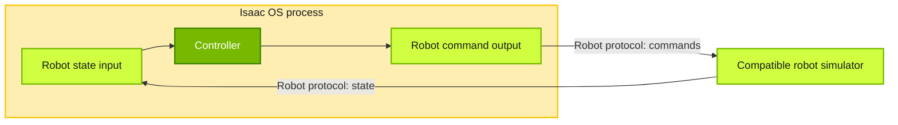
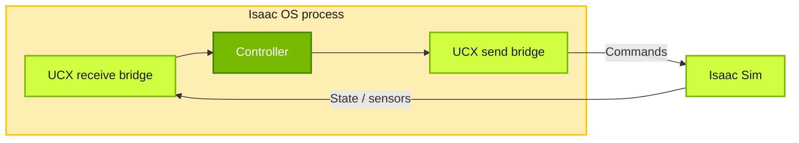

{/*
SPDX-FileCopyrightText: Copyright (c) 2026 NVIDIA CORPORATION & AFFILIATES. All rights reserved.
SPDX-License-Identifier: Apache-2.0
*/}

# Mock, simulation and real modes

<Note>
Developing a controller is slow if every run needs hardware. Modes let an
application run against synthetic data, a simulator or the real robot, usually with
the same controller. This page explains what each mode connects to and what it tells
you. Each application reference documents its modes;
[CLI mode discovery](/isaac-os/reference/cli) lists their names.
</Note>

The diagram below compares the I/O patterns around a shared controller. The
branches are alternatives, not a single application with every mode enabled.

<Warning>
Reusing the controller pipeline across modes makes comparisons more useful,
but mode names do not guarantee the same graph, model, configuration or timing.
For example, [GR00T/G1](/isaac-os/reference/applications/gr00t-n1-7-wbc-g1)
uses different model profiles in mock and Isaac Sim modes, while
[SO-101 sinus](/isaac-os/reference/applications/so101-sinus-motion) uses a
separate simulation graph that bypasses the motion planner used in mock and real
modes. Check the application reference before comparing results across modes.
</Warning>

## Mock

**Mock** replaces robot or simulator I/O with synthetic inputs and a sink inside
the Isaac OS process. The open loop shown here checks execution, output contracts
and pipeline timing without modeling the robot's response to commands.

For example, the [SO-101 reach mock](/isaac-os/reference/applications/so101-reach#mock)
publishes a constant pose without integrating commands, and the
[GR00T/G1 mock](/isaac-os/reference/applications/gr00t-n1-7-wbc-g1)
uses deterministic inputs. These checks do not establish physical behavior or
closed-loop performance.

Synthetic workloads can also include feedback: the
[1 kHz control benchmark](/isaac-os/reference/applications/robot-control-benchmark)
uses a simulated robot plant, rather than the open loop depicted above.

## Real

**Real** mode closes the loop through physical hardware. Input and output
operators use the robot's driver or SDK to receive state and send commands.
For example, [SO-101 reach](/isaac-os/reference/applications/so101-reach)
uses a Feetech serial driver, while [G1 WBC](/isaac-os/reference/applications/wbc-g1)
uses the Unitree SDK over DDS.

## Simulation

**Simulation** closes the loop through a simulated robot and environment.
Depending on the simulator, this can include physics and rendered sensor data.
The reference applications illustrate two I/O patterns; each application's
available modes determine which it supports.

### Vendor-specific simulator

A simulator that implements the robot's protocol can reuse its input and output
operators. For example, [G1 WBC](/isaac-os/reference/applications/wbc-g1) uses the
same robot-facing executable for `real` and `unitree_sim`. Unitree MuJoCo implements the robot
protocol over DDS; `unitree_sim` selects domain 1 and the simulation configuration.

### Isaac Sim (`sim`)

The `sim` mode exchanges state, sensor data and commands with Isaac Sim
over UCX. Each application defines its message schemas, scene and control timing.
Simulator timestamps can affect controller pacing and motion.
Start the simulator and application separately; see
[Isaac Sim setup](/isaac-os/how-to/set-up-isaac-sim).
