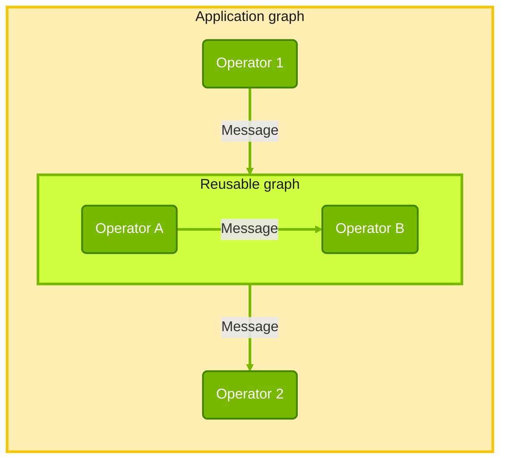

{/*
SPDX-FileCopyrightText: Copyright (c) 2026 NVIDIA CORPORATION & AFFILIATES. All rights reserved.
SPDX-License-Identifier: Apache-2.0
*/}

# Isaac OS Concepts

<Note>
Isaac OS applications are built on [Holoscan SDK 5.0](https://www.holoscan.org/sdk/)
graphs, which can also exchange data with other graphs and frameworks through external
topics. This page introduces the concepts needed to read or write one: operators and
messages, graph composition, execution and connections outside the graph.
</Note>

## Operators, ports and messages

An **operator** is a unit of work. It declares typed input and output **ports** in
`setup()`, timing rules in `contract()`, and processing in `compute()`. Sources can
produce data without an input; sinks can consume data without an output.

A **message** carries a payload between connected ports. Isaac OS uses generated
FlatBuffers schema types for data such as joint states and commands, and schema
payloads containing tensors for images. Holoscan also supports scalar and tensor
payloads. See [payload types](https://docs.nvidia.com/holoscan/sdk-user-guide/5-0-latest/data-and-payloads/payload-type-rules)
and the [Isaac OS message catalog](/isaac-os/reference/components#messages).

A **temporal contract** states what triggers an operator, which input samples it
uses and what to do when data is missing. For example, `OnEach` reacts to each
accepted sample on one input, while `OnClock` drives periodic work. A graph's
**clock** supplies its time domain: applications use real time for hardware and
can use synthetic time for simulation. See [temporal contracts](https://docs.nvidia.com/holoscan/sdk-user-guide/5-0-latest/building-operators/temporal-contracts)
and [time and clocks](https://docs.nvidia.com/holoscan/sdk-user-guide/5-0-latest/getting-started/time-and-clocks).

## Application Composition

An application authors a `holoscan::Graph`. It creates operators and connects their
ports with `add_flow()`. Each edge has bounded queue storage and a delivery policy:
apply backpressure or drop the oldest sample when full.

A **subgraph** groups operators for reuse. Holoscan supports reusable `Graph`
subclasses with exported ports, embedded with `embed()`. Isaac OS also uses helper
functions that add operator groups to a parent graph, such as the
[Unitree simulator subgraph](../../operators/unitree_sim_ucx/unitree_sim_ucx_subgraph.h).

See [graph composition](https://docs.nvidia.com/holoscan/sdk-user-guide/5-0-latest/getting-started/composing-a-graph)
and [reusable graphs](https://docs.nvidia.com/holoscan/sdk-user-guide/5-0-latest/composing-applications/reusable-graphs).

## Compose, compile and run

Composing describes the graph without executing it. `holoscan::compile(graph)`
checks its connections, timing rules and resource bounds, and returns an immutable
**execution plan** with diagnostics. Application code checks `plan.ok()` before
starting the plan with `holoscan::run_async(plan)`.

The returned **run session** owns the running work. The application can request a
stop, wait for completion and inspect the termination status. See
[compiling a plan](https://docs.nvidia.com/holoscan/sdk-user-guide/5-0-latest/getting-started/compile-and-check)
and [running and stopping](https://docs.nvidia.com/holoscan/sdk-user-guide/5-0-latest/getting-started/running-and-stopping).

The plan assigns operators to [execution partitions](https://docs.nvidia.com/holoscan/sdk-user-guide/5-0-latest/composing-applications/graph-composition#execution-partitions). Callbacks within one
partition run serially; different partitions can run concurrently. Several Isaac
OS applications place control, camera and inference work in named partitions.
The [robot control benchmark](/isaac-os/reference/applications/robot-control-benchmark)
shows this placement in use.

## Connections outside the graph

Ports and edges connect operators inside a graph. **Imported and exported topics**
connect the graph to external publishers and subscribers. Isaac OS uses these
boundaries for [ROS 2 transport](/isaac-os/how-to/connect-a-ros-2-graph) and
[MCAP recording](/isaac-os/how-to/record-and-inspect-data-with-mcap-and-foxglove) and
[replay](/isaac-os/how-to/replay-a-recording-into-a-graph).
See [external topics](https://docs.nvidia.com/holoscan/sdk-user-guide/5-0-latest/composing-applications/external-topics)
for the SDK contract.

## Learn about Holoscan basics

- [Your first pipeline](https://docs.nvidia.com/holoscan/sdk-user-guide/5-0-latest/getting-started/first-pipeline)
  walks through a complete application.
- [Writing an operator](https://docs.nvidia.com/holoscan/sdk-user-guide/5-0-latest/getting-started/first-operator)
  explains the operator interface; the [Python guide](https://docs.nvidia.com/holoscan/sdk-user-guide/5-0-latest/python)
  covers Python authoring.
- [Holoscan Modules](https://www.holoscan.org/modules/) and the
  [Isaac OS component catalog](/isaac-os/reference/components) list reusable components.
- [Custom FlatBuffer schemas](https://docs.nvidia.com/holoscan/sdk-user-guide/5-0-latest/data-and-payloads/custom-flatbuffer-schemas)
  explains how to define message payloads.
