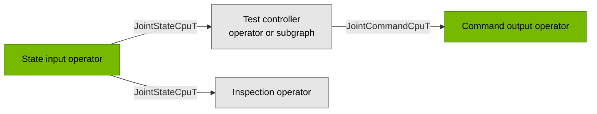

{/*
SPDX-FileCopyrightText: Copyright (c) 2026 NVIDIA CORPORATION & AFFILIATES. All rights reserved.
SPDX-License-Identifier: Apache-2.0
*/}

# Add a robot embodiment

<Note>

This guide provides pointers to support a new robot embodiment on top of the
Isaac OS stack, including identifying the adequate components for integration
with simulators or robot hardware. The intent is to connect robot state and
commands to an Isaac OS application without first deploying a model.

The steps focus on joint I/O. [Sensor I/O](#add-sensor-io) instructions will come in a future release.

</Note>

<llms-ignore>
<Prompt title="✨ Agent prompt: Add robot joint I/O" hidePrompt actions={["cursor"]}>
Find my robot, its target hardware or simulator, and its SDK or assets in our
conversation and project. Ask me for missing details.
Follow [Add a robot embodiment](/isaac-os/how-to/add-a-robot-embodiment) to add
joint state and command I/O. Check the transport, joint mapping and conversions
without motion. Then prepare a bounded-motion test that uses the robot's
commissioning limits.
</Prompt>
</llms-ignore>

## Overview

To support a new robot embodiment, its hardware or simulator needs to connect
to a Holoscan application. **Operators** are the graph components in Holoscan
applications that exchange typed messages through ports; see
[Isaac OS concepts](/isaac-os/explanation/isaac-os-basics). This guide will
focus on configuring or implementing the following operators for the robot:

- **I/O operators:** receive robot state and send commands through a robot SDK or UCX.
- **Test controller:** consume state and generate commands. The intent of this guide
  is to limit that bringup to an operator or a small subgraph without inference.
- **Inspection operator:** log or display state to check the integration.

For the typed messages exchanged in this graph, we recommend to use
`isaac::JointStateCpuT` and `isaac::JointCommandCpuT` from the
[CPU joint schemas](../../common/joint_cpu_messages):



<Tip>

For state-only inspection, you can connect the state input to inspection and leave
out the controller and command output.

</Tip>

<Accordion title="❓ Do I need to use these joint message types?">

While recommended, these schemas are opinionated defaults for ordered CPU
joint arrays, provided for convenience and compatibility with existing Isaac
OS operators and UCX interfaces. Your graph can use its own types and preserve
vendor conventions. Reused components still require their declared port types.

To add a custom graph message in your project:

1. Define its fields in a FlatBuffers `.fbs` schema. The
   [SO-101 state schema](../../common/so101_cpu_messages/state_sample_cpu.fbs)
   adds sequence and fault fields to joint readings.
2. Generate the payload and schema traits with `holoscan_add_flatbuffer_schema`,
   following the [SO-101 message build configuration](../../common/so101_cpu_messages/CMakeLists.txt).
   Set the serialized-size bound for your message, expose the generated headers,
   and link the message library to your operators.
3. Include the generated schema-traits header and use its `...T` payload type on
   connected `holoscan::Input<T>` and `holoscan::Output<T>` ports. Add conversion
   where a component expects a different type.

With stock Isaac Sim UCX nodes, keep the existing wire messages and convert to
your custom type in the application. Changing the wire format also requires a
compatible peer and [UCX message traits and codecs](../../operators/ucxx_ops/message_traits.h).
The [UCX reference](../../operators/ucxx_ops/README.md#wire-format-and-graph-payloads)
lists the wire messages and graph payloads.

</Accordion>

## Identify your robot and gather resources

Identify the following before implementing I/O:

1. The manufacturer, exact model and variant, including any hands, grippers, and
sensors you need.
2. The deployment mode of interest, such as real hardware, vendor simulator, or Isaac Sim; see [application modes](/isaac-os/explanation/application-modes) for the differences.

Check for reusable [operators](../../operators)
and [applications](../../applications),
then gather what is missing:


| Mode             | What to find                                                                                                                                                                                                                                                |
| ---------------- | ----------------------------------------------------------------------------------------------------------------------------------------------------------------------------------------------------------------------------------------------------------- |
| Isaac Sim        | A matching asset in the [Isaac Sim 6.2.0.1 catalog](https://docs.isaacsim.omniverse.nvidia.com/6.2.0/assets/usd_assets_robots.html), a vendor or maintained community USD, or a URDF with its meshes. An asset describes the robot's geometry and articulation. |
| Vendor simulator | Vendor documentation or repositories for the exact model, simulator setup, and exposed state/command APIs                                                                                                                                                   |
| Real robot       | Vendor SDK or documented device protocol, state/command examples, connection setup, and commissioning instructions                                                                                                                                          |


Check each resource's model variant, versions, license, and interfaces.
If an existing ROS 2 driver provides the state, commands, and timing you need,
you can [bridge its messages into your graph](/isaac-os/how-to/connect-a-ros-2-graph)
rather than writing new SDK I/O operators. For a direct connection, use the vendor
SDK or documented protocol.

If you cannot find a compatible vendor simulator, explore Isaac Sim. For missing SDK access or
undocumented control behavior, ask the vendor before attempting hardware control.

## Set up robot I/O

Set up the robot or simulator interface and the Holoscan I/O operators that
connect to it.

<Tabs>

<Tab title="Real Robot" id="embodiment-sdk-real">

### Real Robot

Inspect the vendor's connection, state-read, and command examples before running
them. Establish the API and lifecycle requirements before implementing the
application's I/O.

**1. Identify the SDK and transport.**

Check the SDK's supported firmware versions, runtime dependencies, and required
device or network permissions. Gather the connection parameters from the vendor's
example: device path, baud rate, and motor IDs for a serial bus, or interface,
address, domain, and channel names for a network protocol, as applicable.

<Accordion title="❓ Which SDK language should I use?">

Prefer C++ for high-rate I/O when both language bindings provide the features you
need. A blocking Python SDK call that holds the
[GIL](https://docs.python.org/3.13/c-api/init.html#thread-state-and-the-global-interpreter-lock)
can prevent other Python operators from running. Check whether SDK calls release
it, and measure state and command timing at your required control rate.

</Accordion>

<Accordion title="📄 For example">

The [SO-101 driver configuration](../../common/so101_driver/feetech_serial_driver.h)
takes a serial port and calibration file containing motor IDs.
The [G1 configuration](../../operators/g1_low_level/g1_params.h)
provides `network_interface`, `dds_domain_id`, and the configured motor count.

</Accordion>

**2. Identify the state-read path.**

Find the polling function or subscription callback and its message definition.
Record:

- Joint fields, addressing, units, direction, calibration zeros, and limits,
  plus any required sensor frames and timestamps, for
  [mapping and conversion](#map-and-convert-state-and-commands).
- Return codes and validity or fault flags that distinguish usable data, no new
  sample, and communication failure.
- A sequence, device tick, timestamp, or callback event that distinguishes new
  samples from cached values. Use it to detect stale state.

<Accordion title="📄 For example">

The [SO-101 driver](../../common/so101_driver/feetech_serial_driver.cc)
uses `read_present_positions_and_velocities()` and reports read
failure through its return value. The
[G1 state subscriber](../../operators/g1_low_level/g1_low_level_joint_state_subscriber.cc)
receives `LowState` on `rt/lowstate`, extracts joints and IMU, and counts callbacks
to wait for a new sample before emitting state.

</Accordion>

<Warning>

Before running a reference application to inspect state, check its startup:
SO-101 driver initialization homes the arm, and G1's command operator releases the
onboard control mode before receiving commands.

</Warning>

**3. Identify the command-write path.**

Find the write function or publisher and establish its command contract before
sending motion:

| Identify | Use in the adapter |
| --- | --- |
| Motor addressing and control mode | Select the SDK slots or IDs and position, velocity, effort, or hybrid mode |
| Applied fields | Translate the supported position, velocity, effort, and gain fields; identify fields the backend ignores |
| Required protocol fields | Populate enable flags, mode values, sequence numbers, or checksums required by the vendor |
| Update rate and watchdog | Schedule writes at the required cadence and define what happens if commands stop |

<Accordion title="📄 For example">

The [SO-101 driver](../../common/so101_driver/feetech_serial_driver.cc)
sends desired joint positions through `send_action()`; servo gains come from
driver configuration. The
[G1 command publisher](../../operators/g1_low_level/g1_low_level_joint_command_publisher.cc)
fills `LowCmd.motor_cmd` with position, velocity, effort, and `kp`/`kd`, enables the
motors, sets the mode fields, calculates the checksum, and writes to `rt/lowcmd`.

</Accordion>

**4. Define startup, ownership, and stopping.**

Find the vendor's commissioning procedure, control-mode API, and watchdog or fault
documentation. Establish:

- The startup order: open the transport, obtain usable state, initialize or enable
  motors, and take control in the order the vendor requires. Identify any startup
  movement and which joints lose their existing controller.
- How to confirm takeover and handle a failed or ambiguous handoff.
- The required response to normal shutdown, startup failure, stale state, rejected
  commands, and communication loss. The response can differ by event.

Common responses to check in that documentation are:

| Response | What to find |
| --- | --- |
| Hold position | Supported hold API or command format, required feedback and gains, and whether commands must keep arriving |
| Disable motors | Torque-off or motor-disable API, confirmation status, and any mechanical support required before disabling |
| Return control | Controller handoff API, the receiving controller's required state, and how to confirm it has taken control |

Use the vendor's prescribed response for each event. If the documentation does not
establish these behaviors, resolve them with the vendor before hardware tests.

<Warning>

A stop, hold, or handoff request may not reach the robot after communication loss.
Check the device's documented watchdog response to know what happens when commands
stop arriving.

</Warning>

**5. Bridge the application to the robot interface.**

Reuse matching operators if available. Otherwise, implement Holoscan operators
around the SDK or protocol calls identified above. Split the bridge's responsibilities
between the operators and any shared driver/session:

- In the operators, expose state output and command input ports. Emit readings from the state API
  and send received commands through the command API.
- Implement startup and shutdown in a shared driver/session or the operators'
  `start()` and `stop()` methods.
- In the driver or I/O operators, reject unusable state and invalid commands, and
  handle each fault with the response identified in step 4.
- Keep stopping with the connection lifecycle. Check hold, disable, or handoff
  results before stopping callbacks and closing the connection. Report failures
  rather than treating disconnection as a successful stop.

<Accordion title="❓ When should the driver be separate from the operator?">

Separate a driver/session when multiple operators share a bus, connection, or control
lifecycle, or when you need to test device communication without a graph.
The [SO-101 driver and operators](../../operators/so101/README.md#hardware-driver)
share one serial connection. The
[G1 low-level operators](../../operators/g1_low_level)
call the SDK directly from independent publishers and subscribers.
Separate state and command operators are optional; a coupled interface can expose
both ports.

</Accordion>

</Tab>

<Tab title="Vendor simulator" id="embodiment-sdk-sim">

### Vendor simulator

If the vendor simulator exposes compatible SDK or protocol APIs, reuse the
[real robot I/O steps](#real-robot) and operators.
Check the joint variant, networking configuration, ownership services, and required
sensors, not just the state and command message types. Otherwise, write an adapter
for its own interface or use its ROS bridge.

<Tip>

For reference, the [WBC mode configuration](../../applications/wbc_g1/metadata.json)
of the Unitree G1 reuses the hardware executable for `unitree_sim` with DDS based
on [Unitree MuJoCo](https://github.com/unitreerobotics/unitree_mujoco#installation).

</Tip>

</Tab>

<Tab title="Isaac Sim" id="embodiment-isaac-sim">

### Isaac Sim

**1. Inspect the robot asset.**

Load your USD or [import the URDF](https://docs.isaacsim.omniverse.nvidia.com/6.2.0/importer_exporter/ext_isaacsim_asset_importer_urdf.html),
then check the details needed for joint I/O:

| Check | Use |
| --- | --- |
| Articulation root path | Point the reader and controller at this path below. SO-101 uses `/so101_new_calib/root_joint`; G1 uses `/g1/pelvis`. |
| Joint names, axes, and limits | Inspect the joint prims. After adding the reader, check its `outputs:jointNames` order before mapping commands to those joints. |
| Drives and initial pose | Check stiffness, damping, desired joint positions, and whether the base is fixed or free before running the scene. These settings determine its starting state and response to commands. |

<Accordion title="❓ Can command kp/kd values change Isaac Sim drive gains?">

Isaac OS `JointCommand` messages contain `kp` and `kd`; the G1 hardware publisher
passes them to the robot SDK. The stock Isaac Sim UCX subscriber exposes position,
velocity, and effort, but no gain outputs; `IsaacArticulationController` has no gain
inputs either. This wiring uses stiffness and damping authored on the USD joint drives.

For per-command gains, add a simulator adapter that receives `kp`/`kd` and updates
the articulation gains through an Isaac Sim API such as
[`Articulation.set_dof_gains`](https://docs.isaacsim.omniverse.nvidia.com/6.2.0/py/source/extensions/isaacsim.core.experimental.prims/docs/index.html#isaacsim.core.experimental.prims.Articulation.set_dof_gains).
The stock UCX nodes alone do not provide that path.

</Accordion>

**2. Add the ActionGraph and its nodes.**

Create a USD layer that references your robot asset - which provides the articulation,
joints, and drives - and adds an `ActionGraph`. An [Action Graph](https://docs.isaacsim.omniverse.nvidia.com/6.2.0/omnigraph/omnigraph_tutorial.html)
is Isaac Sim's general graph for connecting simulation nodes; UCX is one way to
exchange data through it which Isaac OS relies on today.

Name the graph `ActionGraph` because the launcher enables graphs with that
name when a UCX client connects, and add these nodes inside it:

- [`omni.graph.action.OnPlaybackTick`](https://docs.isaacsim.omniverse.nvidia.com/6.2.0/omnigraph/omnigraph_tutorial.html#building-the-graph)
  to start the state update on each playback tick. For control at a fixed
  simulation-time rate,
  use `isaacsim.core.nodes.OnPhysicsStep` and an `IsaacSimulationGate` named
  `physics_control_gate` instead, following
  [Physics and control rate](/isaac-os/how-to/set-up-isaac-sim#physics-and-control-rate).
- [`isaacsim.core.nodes.IsaacReadSimulationTime`](https://docs.isaacsim.omniverse.nvidia.com/6.2.0/py/source/extensions/isaacsim.core.nodes/docs/ogn/OgnIsaacReadSimulationTime.html)
  to supply the simulation timestamp.
- [`isaacsim.sensors.physics.IsaacReadJointState`](https://docs.isaacsim.omniverse.nvidia.com/6.2.0/py/source/extensions/isaacsim.sensors.physics.nodes/docs/ogn/OgnIsaacReadJointState.html)
  to read the articulation.
- [`isaacsim.core.nodes.IsaacArticulationController`](https://docs.isaacsim.omniverse.nvidia.com/6.2.0/py/source/extensions/isaacsim.core.nodes/docs/ogn/OgnIsaacArticulationController.html)
  to apply joint commands to the articulation.
- [`isaacsim.ucx.nodes.UCXPublishJointState`](https://docs.isaacsim.omniverse.nvidia.com/6.2.0/py/source/extensions/isaacsim.ucx.nodes/docs/ogn/OgnUCXPublishJointState.html)
  to send state to Isaac OS.
- [`isaacsim.ucx.nodes.UCXSubscribeJointCommand`](https://docs.isaacsim.omniverse.nvidia.com/6.2.0/py/source/extensions/isaacsim.ucx.nodes/docs/ogn/OgnUCXSubscribeJointCommand.html)
  to receive commands from Isaac OS.

For each sensor stream your application consumes, find its prim and parent frame,
then add the reader and UCX publisher nodes. Add a simulation-clock publisher only
if the application consumes it. Use the same trigger for joint and sensor readers
when the consumer requires matching capture timestamps.

**3. Point the reader and controller at the robot.**

Set both inputs to the robot's articulation root path identified above:

- `IsaacReadJointState.inputs:prim`
- `IsaacArticulationController.inputs:targetPrim`

**4. Connect the graph nodes.**

| From output | To input |
| --- | --- |
| `OnPlaybackTick.outputs:tick` or `physics_control_gate.outputs:execOut`, for the selected trigger | `IsaacReadJointState.inputs:execIn` |
| `IsaacReadJointState.outputs:execOut` | `UCXPublishJointState.inputs:execIn` |
| `IsaacReadJointState.outputs:jointPositions` | `UCXPublishJointState.inputs:jointPositions` |
| `IsaacReadJointState.outputs:jointVelocities` | `UCXPublishJointState.inputs:jointVelocities` |
| `IsaacReadJointState.outputs:jointEfforts` | `UCXPublishJointState.inputs:jointEfforts` |
| `IsaacReadSimulationTime.outputs:simulationTime` | `UCXPublishJointState.inputs:timeStamp` |
| `UCXPublishJointState.outputs:execOut` | `UCXSubscribeJointCommand.inputs:execIn` |
| `UCXSubscribeJointCommand.outputs:execOut` | `IsaacArticulationController.inputs:execIn` |
| `UCXSubscribeJointCommand.outputs:positionCommand` | `IsaacArticulationController.inputs:positionCommand` |
| `UCXSubscribeJointCommand.outputs:velocityCommand` | `IsaacArticulationController.inputs:velocityCommand` |
| `UCXSubscribeJointCommand.outputs:effortCommand` | `IsaacArticulationController.inputs:effortCommand` |
| `IsaacReadJointState.outputs:jointNames` | `IsaacArticulationController.inputs:jointNames` |

<Note>
This last `jointNames` connection assumes commands use the reader's joint order.
Otherwise, reorder commands before `IsaacArticulationController`, or send them in
the reader's order from the application; see
[Map and convert state and commands](#map-and-convert-state-and-commands).
</Note>

<Accordion title="📄 For example">

The [G1 scene](../../operators/unitree_g1/assets/g1_ucx.usda)
maps articulation order to SDK order before publishing and reverses it before
articulation control. Agree on the UCX joint order and apply each direction's
mapping once, in the scene or the application.

</Accordion>

**5. Configure UCX and run the scene.**

1. Give each UCX node an `inputs:port` attribute. The `./isaac_sim` launcher
  sets it to the selected port from `--port` or to `50008` by default.
2. Set a nonzero `inputs:timeoutMs` on UCX publishers to avoid an immediate send
  timeout. For state-only inspection, set a finite positive `inputs:timeoutMs` on
  `UCXSubscribeJointCommand` too, so missing commands do not block reception
  indefinitely.
3. Identify the two `inputs:tag` values in the USD: `UCXPublishJointState` uses
  one for joint state, and `UCXSubscribeJointCommand` uses another for joint
  commands. Set distinct values if default values match.

Follow [Set up Isaac Sim](/isaac-os/how-to/set-up-isaac-sim) to run Isaac Sim and
wait for the Isaac OS application.

```bash
./isaac_sim run --scene path/to/your_scene.usda
```

If your application uses another port, pass `-- --port <port>` to this command.

**6. Bridge the application to the scene.**

Now build the Isaac OS side of the connection. Its operators run in the application
process, while the ActionGraph nodes above run in Isaac Sim.

- Reuse `UcxxReceiverOp<JointStateCpuT>` for state and
`UcxxSenderOp<JointCommandCpuT>` for commands with a shared `UcxxEndpoint`, as in
the [SO-101 sim graph](../../applications/so101_sinus_motion/sim/main.cc).
Match the endpoint's host and port to the simulator.
- Pass the scene's joint-state publisher `inputs:tag` as the receiver's `tag`
argument, and the scene's joint-command subscriber `inputs:tag` as the sender's
`tag` argument. Node defaults: `0xe2e1a077` for state and `0x3ad708d3` for commands.

<Accordion title="📄 For example">

See the [SO-101 scene](../../operators/so101/assets/so101_ucx_robot_only.usda)
for joint I/O and the [G1 scene](../../operators/unitree_g1/assets/g1_ucx.usda)
for IMU, clock, control-rate gate, and joint reordering.

</Accordion>

</Tab>

</Tabs>

---

## Connect the application graph

Connect the I/O from your selected mode to a test controller.

### Choose a test controller

Look for vendor commissioning or basic-motion examples. Reuse their callable
command-generation logic or adapt it into an operator, then send commands through
your output operator. Your controller must choose the command values sent through
the SDK's command API. Reuse the controller across modes when state and command
semantics and the control mode match. Once I/O is validated, you can replace the
test controller with model-based control compatible with your robot.

**For an arm that supports position control**, a measured-pose hold or small
joint ramp or sine motion can be a first test. Choose starting joint positions
from validated state and set bounds, speeds, and gains for that robot.

<Accordion title="📄 Example: SO-101 command generation without inference">

The [SO-101 hardware graph](../../applications/so101_sinus_motion/real/main.cc)
uses `SinusMotionOp` to generate desired joint positions and `SimpleMotionPlannerOp` to
limit each step relative to measured state. Both consume SO-101's state type;
the sine generator uses one amplitude for all joints.

The [SO-101 sim generator](../../applications/so101_sinus_motion/sim/sinus_motion_op.cc)
consumes `JointStateCpuT` and directly emits `JointCommandCpuT`, with sine phase
driven by simulation timestamps.

</Accordion>

**For a humanoid**, choose the controller for the check you need:

| Check | Controller requirement |
| --- | --- |
| Inspect state | Use a documented non-actuating read path; no command generator is needed |
| Joint I/O on mechanical support | Adapt the vendor's supported hold and selected-joint test routine, using its prescribed commands, gains, control modes, and cadence |
| Balance or locomotion | Use a balancing controller compatible with the exact embodiment and its sensors |

If takeover affects the whole body, provide valid commands for every affected
joint, including those not under test. Zero-filled or omitted fields are not a
general way to leave those joints under onboard control. Isaac OS does not provide
a generic humanoid commissioning application.

<Warning>

For a humanoid, use the vendor's commissioning procedure, including any required
mechanical support. A gantry alone does not establish safe control. Position hold
is not balance. Stay with non-actuating checks if ownership and stopping behavior
are unknown.

</Warning>

<Accordion title="❓ Can I reuse the G1 controller for another humanoid?">

The [G1 WBC application](/isaac-os/reference/applications/wbc-g1#architecture)
uses a G1-specific policy and configuration. Changing joint order alone does not
adapt that balancing policy to a different robot.

Its real graph places
[`StartUpOp`](../../operators/start_up/start_up_op.cc)
between WBC and command output. The operator provides startup ramps, holds, and
enable gating, but runs on incoming controller commands. Removing WBC does not
turn this graph into a standalone commissioning controller.

</Accordion>

### Map and convert state and commands

You now have robot I/O and a controller, but their message types, joint order, or
units may differ. Without mapping, a command can target the wrong joint or angle.
Connect them in both directions:

- **State:** convert I/O output into the controller's expected input.
- **Commands:** convert controller output into the format accepted by I/O.

Validate received state and commands, then implement the required conversions:

| Convert | Implementation |
| --- | --- |
| Joint identity | Map graph joints to simulator joints or SDK motor slots in both directions; handle reserved or separately controlled joints explicitly |
| Values | Convert units and direction. Apply calibrated zero offsets to positions, not velocities. Check converted commands against device limits |
| Command fields | Populate the fields and enable/mode values required by the selected control mode |
| Timestamps | Preserve capture timestamps and their clock domain; explicitly use receive time when capture time is unavailable |
| Sensor conventions, if used | Convert coordinate frames and quaternion conventions to match the consumer |

<Tip>

- Prefer keeping SDK-specific conversion in the driver or I/O operators so the
controller can be reused across modes. Doing that conversion inside a custom
controller is also possible, but makes it depend on the robot SDK's data format.
- A separate adapter operator is an option when conversion is needed and you want
to leave existing operators unchanged. For example, it can receive and emit
`JointStateCpuT` while reordering joints, without introducing a new message type.
- With stock UCX I/O, conversion can also run in the Isaac Sim scene.
- If types and conventions match, no adapter is needed.

</Tip>

<Accordion title="📄 Examples: joint mapping and conversion">

Suppose a backend reports `[elbow, shoulder]` in degrees while the
graph expects `[shoulder, elbow]` in radians, with matching zeros and directions:

| Direction | Input | Converted output |
| --- | --- | --- |
| State to graph | `[90, 30]` degrees | `[π/6, π/2]` radians |
| Position command to backend | `[π/4, π/3]` radians | `[60, 45]` degrees |

Implementation examples:

- [SO-101 reach state adapter](../../applications/so101_reach/sim/sim_adapters.h):
  validates joint arrays, populates the graph's state type, and preserves capture metadata.
- [SO-101 hardware driver](../../common/so101_driver/feetech_serial_driver.h):
  keeps calibration and unit conversion in the driver, with graph I/O in the operators.
- [G1 command publisher](../../operators/g1_low_level/g1_low_level_joint_command_publisher.cc):
  maps graph command fields into SDK motor slots, including enable fields and checksums.

</Accordion>

### Assemble an application

Compose the state input, controller, and command output in your application.

Use the [SO-101 application composition](../../applications/so101_sinus_motion/real/main.cc)
as a wiring example, replacing its I/O and controller assumptions with your mapping.
For using Isaac OS components in your own repository, see
[Integrate in your project](/isaac-os/how-to/integrate-in-your-project).

<Accordion title="Example: extend the Isaac OS reference repository">

Following the [SO-101 application](../../applications/so101_sinus_motion):

- Create `applications/<your_app>/` with a graph entrypoint, configuration, and
`CMakeLists.txt`.
- Register the application and its dependencies with `add_isaac_application` in
[`applications/CMakeLists.txt`](../../applications/CMakeLists.txt).
Follow the selected mode's CMake file for its executable and linked components.
Register new shared libraries with `add_isaac_common` in
[`common/CMakeLists.txt`](../../common/CMakeLists.txt)
and new operators with `add_isaac_operator` in
[`operators/CMakeLists.txt`](../../operators/CMakeLists.txt).
- Add `metadata.json` with the application name and run command for each implemented
mode, including a mock if useful for checking wiring without hardware.
Check discovery with `./isaac_os modes <your_app>`, then follow
[Build and run](/isaac-os/how-to/build-and-run).

</Accordion>

## Add sensor I/O

<Warning>

Coming soon: sensor setup, conversion, and validation instructions will be added in a future release.

</Warning>

**Available now:** the [UCX operators](../../operators/ucxx_ops/README.md#wire-format-and-graph-payloads)
support IMU and image messages.

### Pair joint state and sensor data

Before connecting joint state and other sensor streams, check the receiving
operator's input timing contract (`contract()` in a C++ operator):

- If it requires identical capture timestamps, provide related samples from the
  same simulation step or acquisition event and preserve their common timestamp.
- If it permits different capture times, pair samples within its allowed time
  window and respect its stale-input limits.

Convert timestamps to the same clock domain before comparing them.

<Accordion title="📄 Example: G1 joint state and IMU pairing">

The [G1 hardware subscriber](../../operators/g1_low_level/g1_low_level_joint_state_subscriber.cc)
extracts joint state and IMU from one SDK message and emits both with the same
graph timestamp. That timestamp is not a measured device capture time.
The [G1 simulation adapter](../../operators/unitree_sim_ucx/unitree_sim_ucx_ops_adapter.cc)
receives separate messages. Both it and the
[G1 WBC controller](../../operators/agile_wbc/agile_wbc_op.cu)
use `OnAligned` with a zero window, requiring identical capture timestamps.

</Accordion>

## Check the integration

1. **Check conversion without motion.** Before connecting command output to hardware,
 test both directions with distinct per-joint values in a different order. Verify
 units, sign/zero conversion, limits, and rejection of malformed input.
2. **Inspect received state before motion.** After connecting the backend and
 application, use a documented non-actuating path where available. Check joint
 identity, plausible values, and fresh samples. Repeated SDK reads may return the
 same sample.
3. **Test bounded commands.** Follow the robot's commissioning procedure. For an arm,
 a small movement can check joint identity, direction, scale, and tracking. Select
 amplitudes, centers, speeds, and gains for that robot; do not copy reference defaults.
4. **Check stopping and failures.** Verify the expected response to stale state,
 invalid commands, failed communication, and shutdown, beginning with mocks or
 simulation and using vendor procedures for physical tests.

When the integration works, reduce latency and jitter with
[Optimize your host](/isaac-os/how-to/optimize-your-host) and
[Optimize an Application](/isaac-os/how-to/optimize-an-application).

<Accordion title="⚠️ Joint state never arrives or stops updating in Isaac Sim">

If state never arrives, check the UCX publisher's `inputs:timeoutMs`. The SO-101
scene reports that `0` causes an immediate send timeout and uses `4294967295` to
wait indefinitely.

If state arrives once and stops, an indefinite command-reception wait may block
the next simulation tick. Set a finite receive timeout or send commands each tick.
Also check other waits in the execution chain, including clock and sensor publishers.
The [SO-101 reach scene layer](../../operators/so101/assets/so101_reach_ucx_with_env.usda)
bounds the command wait and disconnects clock and camera publication.

</Accordion>

<Accordion title="❓ Which clock should check state freshness?">

Compare timestamps from the same clock domain. For wall-time age checks, use
compatible receive timestamps or convert the source timestamps. A simulator-driven
clock can stop when messages stop. Ensure a freshness monitor still runs without
new input: a periodic trigger alone does not override a missing-input policy that
skips execution. Queue depth does not enforce freshness or replace a device watchdog.

</Accordion>

<Accordion title="⚠️ A command moves the wrong joint or in the wrong direction">

Stop motion and recheck the graph-to-device mapping. Compare joint names or motor
slots, array order, positive axes, calibration zeros, and units. An unnamed state
array cannot validate its own joint identity. Repeat conversion tests before
resuming a bounded movement under the supported commissioning procedure.

</Accordion>
