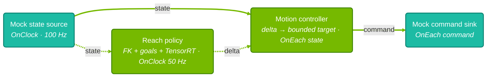

{/*
SPDX-FileCopyrightText: Copyright (c) 2026 NVIDIA CORPORATION & AFFILIATES. All rights reserved.
SPDX-License-Identifier: Apache-2.0
*/}

# SO-101 Reach Task - Part 4: Benchmarking the Pipeline

<Note>
Latency and cadence tell you whether the reach pipeline keeps up with the arm. This
part profiles a mock-mode run with Nsight Systems, reports both for two paths through
the graph, and records the conditions behind the numbers.
</Note>

# Prerequisites

Before starting, ensure you have:

1. **The Isaac OS repository** cloned and its Docker image built. See
   [Getting Started](/isaac-os/tutorials/getting-started).
2. **A CUDA-capable GPU.** The policy runs TensorRT inference.
3. **Familiarity with the reach graph** from
   [Part 3: Deployment](/isaac-os/tutorials/so101-reach/deployment#how-the-application-works).

You do not need to install Nsight Systems. The Isaac OS application container runs both
the capture and the report.

<Tip>

On Jetson AGX Thor, check the host before you capture:

```bash
python3 tools/host_preflight.py
```

Resolve its warnings with
[Optimize your host](/isaac-os/how-to/optimize-your-host#check-your-configuration).

</Tip>

# What You Will Measure

Mock mode runs the same policy and motion controller as the real arm. A mock state source
publishes a constant pose at 100 Hz, and a mock sink receives the commands. With no robot
I/O, the measurement isolates the graph and TensorRT inference. The arm never moves, so
mock mode does not measure task performance, and every goal times out by design.

<Note>
This part measures mock mode only. The `sim` and `real` modes stop at startup when
Nsight Systems traces NVTX, so they cannot be profiled with this procedure.
</Note>

The `data_flow_tracking` report follows messages along a chain of operator ports. It
measures each response from the start of the source operator's callback to the end of
the sink operator's callback, so waits between operators count toward the latency.



The solid edges form the **command path**. The **policy path** follows the dotted edges
into the motion controller, then shares the command edge.

## The command path

The controller runs on every state sample. It re-clamps the held policy target against
the fresh measurement and emits one bounded command. The latency of this path is how long
a new measurement takes to become a command. Its cadence is the command rate, which
follows the 100 Hz state rate.

## The policy path

The policy path follows a state sample through TensorRT inference to the first command
that carries the new target. Its latency is about 20 ms, made of two 10 ms waits rather
than inference.

<Accordion title="❓ Why is the policy path about 20 ms?">

- The policy runs on its own 50 Hz clock, which ticks together with the 100 Hz state
  source. It takes the freshest state sample, which is usually the one from the previous
  10 ms tick, so the sample is already 10 ms old when inference starts.
- Inference takes about 0.2 ms. The controller applies the new target only when the next
  state sample arrives, 10 ms later.

Rarely, the controller runs right after inference on the same tick, and the response
takes about 10 ms.

</Accordion>

The policy uses every second state sample, so about half of the samples have no response
on this path. That is by design, not message loss.

# Set the Measurement Window

Decide the window before you capture, so the run is long enough to cover it. The report
counts the warmup and the window in state messages from the source port. Both paths share
that source, so one window describes both.

| Setting | Value |
| --- | --- |
| Warmup | 1,000 state messages (10 s) |
| Window | 30,000 state messages (300 s) |
| Trailing margin | 100 messages |
| `--message-count` | 31,100 commands |
| `--completion-timeout-seconds` | 400 |

**Latency budgets:** 10 ms for the command path and 40 ms for the policy path.

<Accordion title="❓ Why these settings?">

- Warmup skips graph startup and the few states before the first policy target.
- The window leaves about 30 command-path and 15 policy-path responses above p99.9.
- The 400-second completion timeout is above the run's 311 seconds; the default 30 seconds
  ends long captures with an error.

The command-path report compares each command interval with the expected period of 10 ms,
the default `state_source.period`. The policy-path report omits the expected period. A
policy target applied on the same tick produces one 10 ms and one 30 ms interval, so the
period error depends on how often that happens, not on jitter.

- The command-path budget is one state period.
- The policy-path budget is the default `motion_control.target_expiry`, the age at which
  the controller discards a policy target.

</Accordion>

For how to size a window for another application, see
[Choose the warmup and window](/isaac-os/how-to/profile-an-application#choose-the-warmup-and-window).

For a window of N state messages, expect these counts:

- **Command path:** `Eligible Sources` is N, and `Selected` is N minus the states without
  a valid policy target. In mock mode, that is N.
- **Policy path:** `Eligible Sources` is N, and `Selected` is N / 2, one per inference.

# Building and Warming Up

Build the application:

```bash
./isaac_os build so101_reach
```

Holoscan SDK 5 emits the data-flow markers that the report reads, so the regular build is
the one you profile. Then run mock mode once without profiling:

```bash
./isaac_os run so101_reach mock
```

If no TensorRT engine is cached yet, this run builds one beside the policy. Later runs
load the cached engine, so captures start without the engine build.

# Capturing a Profile

Close other GPU and CPU-heavy work, such as builds or Isaac Sim, first. The run writes to
its own directory under `build/benchmarks/so101_reach/`:

```bash
OUT="build/benchmarks/so101_reach/mock"
mkdir -p "$OUT"

./isaac_os run so101_reach mock --no-local-build --no-docker-build \
  --nsys-args="--trace=nvtx --sample=none --backtrace=none --cpuctxsw=none --force-overwrite=true -o /workspace/isaac_os/$OUT/profile" \
  -- --message-count=31100 --completion-timeout-seconds=400 > "$OUT/application.log" 2>&1
```

The capture takes about 311 seconds. The options match
[Profile an Application](/isaac-os/how-to/profile-an-application).

The mock sink accepts each command before the controller sends the next one. If a busy
host delays the sink by one state period, the run stops early with `kBackpressured` in
the log. Count such a run as failed and run it again on an idle host.

# Exporting the Capture

From the same host shell, open the run directory in the application container:

```bash
./isaac_os run-container so101_reach mock --no-docker-build -- \
  "cd /workspace/isaac_os/$OUT && exec bash"
```

Stay in the container until [Reading the Results](#reading-the-results). Export the
capture to SQLite with message payloads:

```bash
nsys export --type sqlite --include-blobs=true --force-overwrite=true \
  -o profile.sqlite profile.nsys-rep
```

The report matches emitted and received messages by their payloads, so the export needs
`--include-blobs=true`.

# Selecting the Measured Paths

List every path the report can reconstruct:

```bash
nsys stats --report-dir /workspace/isaac_os/tools/profiling \
  --report data_flow_tracking \
  --format csv --timeunit msec --force-overwrite=true --output all-paths \
  profile.sqlite 2> all-paths.stderr
```

This writes `all-paths_data_flow_tracking.csv` with one row per path. Mock mode has exactly
two rows. Save each row's `Port Path` on a single line:

```bash
cat > command-path.txt <<'EOF'
mock_state_source.out_state -> so101_motion_control.in_state -> so101_motion_control.out_command -> mock_command_sink.in_command
EOF

cat > policy-path.txt <<'EOF'
mock_state_source.out_state -> so101_reach_policy.in_state -> so101_reach_policy.out_delta -> so101_motion_control.in_delta -> so101_motion_control.out_command -> mock_command_sink.in_command
EOF
```

# Measuring Latency and Cadence

Report each path over the window:

```bash
nsys stats --report-dir /workspace/isaac_os/tools/profiling \
  --report 'data_flow_tracking:port-path-file=command-path.txt:responses=first:warmup=1000:window=30000:expected-period-ns=10000000:latency-budget-ns=10000000' \
  --format json --timeunit msec --force-overwrite=true --output command \
  profile.sqlite 2> command-report.stderr

nsys stats --report-dir /workspace/isaac_os/tools/profiling \
  --report 'data_flow_tracking:port-path-file=policy-path.txt:responses=first:warmup=1000:window=30000:latency-budget-ns=40000000' \
  --format json --timeunit msec --force-overwrite=true --output policy \
  profile.sqlite 2> policy-report.stderr
```

`responses=first` keeps one command per state sample on each path. See
[Customize the report](/isaac-os/how-to/profile-an-application#customize-the-report)
for every option.

# Reading the Results

Read the saved warnings first. All three files are empty for a clean capture:

```bash
cat all-paths.stderr command-report.stderr policy-report.stderr
```

Then print both measured rows. Nsight Systems adds the report options to each output file
name, so find the files by prefix:

```bash
for report in command_data_flow_tracking*.json policy_data_flow_tracking*.json; do
  echo "$report"
  python3 -m json.tool "$report"
done
```

These fields matter most:

| Field | Command path | Policy path |
| --- | --- | --- |
| `Eligible Sources` and `Selected` | Window size, and states that produced a command | Window size, and states the policy used |
| `P50 (ms)` to `Max (ms)` | Measurement-to-command latency | State-to-target latency, including both waits |
| `Sink Completion Hz` | Command rate, 100 Hz | Target rate, 50 Hz |
| `Sink Period Error P99.9 (ms)` | Jitter in the command rate | Not reported |
| `Latency Budget Exceedances` | Commands slower than 10 ms | Targets older than 40 ms |

Leave the container with `exit`. On the host, read the run summary from the log:

```bash
grep -E 'reach policy inferences|joint commands for' "$OUT/application.log"
```

The summary covers the whole run, and the report covers only the window. They agree when
the counts reconcile:

- **Commands for states.** `Sent 31100 joint commands for 31103 joint states` means three
  states arrived before the first policy target and produced no command. Expired targets
  would also leave states without a command.
- **Inferences.** `Ran 15551 reach policy inferences ... skipped 0` matches about half of
  the states. A skipped inference found no state sample newer than one policy period.

| What you see | What it means |
| --- | --- |
| Command-path `Selected` equal to the window, no expired targets, no budget exceedances | The pipeline kept up for the whole window |
| Skipped inferences or expired targets | The host delayed the state source or the policy. Look for other load |
| A command-path maximum far above p99.9 | A single delay. Export per-response samples with `view=samples` to see when it happened |
| A policy-path p50 far from 20 ms | The policy or state period differs from the defaults |

## Compare With the Example Results

These example results come from one run of this procedure on an x86 workstation.
They are not a benchmark record: published application benchmarks target Jetson AGX Thor.
Use them to check that your capture has the expected shape: the counts, the 100 Hz command
rate and the policy path of about 20 ms.

<Accordion title="Example run configuration">

- **Run date:** October 21, 2026, a 300-second window.
- **Host:** AMD Ryzen Threadripper PRO 3955WX, Linux 6.8.0-146-generic, no CPU isolation,
  clocks not locked.
- **GPU:** NVIDIA RTX 5880 Ada Generation, driver 580.178.04.
- **Tools:** Holoscan SDK 5.0.0, CUDA 13.2.51, TensorRT 10.16.0.72, Nsight Systems
  2026.4.1.191.
- **Policy:** default model, SHA-256 `25e08afb6bc6cd62…`, TensorRT engine loaded from cache.
- **Configuration:** default `so101_reach_config.yaml`.
- **Other workloads:** a desktop session only; no other compute work on the GPU.
- **Measurement:** warmup 1,000 and window 30,000 state messages, `responses=first`.

</Accordion>

<Accordion title="📄 Example results">

| Path | Selected | p50 (ms) | p99 (ms) | p99.9 (ms) | Max (ms) | Sink rate (Hz) | Period error p99.9 (ms) | Over budget |
| --- | ---: | ---: | ---: | ---: | ---: | ---: | ---: | ---: |
| Command | 30,000 | 0.068 | 0.123 | 0.150 | 1.825 | 100.00 | 0.160 | 0 |
| Policy | 15,000 | 20.068 | 20.129 | 20.178 | 20.493 | 50.00 | Not reported | 0 |

The command-path budget is 10 ms and the policy-path budget is 40 ms.

The run ended with this summary:

```text
Ran 15551 reach policy inferences in 311.0s and skipped 0 without a fresh joint state.
Sent 31100 joint commands for 31103 joint states; 0 policy targets expired before the next one arrived.
```

</Accordion>

Repeating the capture shows how deterministic the pipeline is on your host: percentiles
should stay close between runs, while maxima vary more. To reduce latency and jitter, see
[Optimize your host](/isaac-os/how-to/optimize-your-host) and
[Optimize an Application](/isaac-os/how-to/optimize-an-application).

# Recording Conditions and Artifacts

Record the conditions of the run, following
[Record conditions and artifacts](/isaac-os/how-to/profile-an-application#record-conditions-and-artifacts).
On the host:

```bash
{
  date -u +%Y-%m-%dT%H:%M:%SZ
  git rev-parse HEAD
  git status --short
  uname -r
  nvidia-smi --query-gpu=name,driver_version --format=csv,noheader
} > "$OUT/conditions.txt"
```

Record the tool versions and the policy hash from inside the container:

```bash
./isaac_os run-container so101_reach mock --no-docker-build -- \
  "nsys --version > $OUT/versions.txt && sha256sum data/grip_reach_delta_policy_onnx/policy_fingertip_delta.onnx >> $OUT/versions.txt"
```

The TensorRT version is part of the engine file name in `application.log`. Note other
workloads on the host yourself, because nothing in the capture records them.

Keep these files from the run directory:

| File | Why keep it |
| --- | --- |
| `application.log` | Run summary, engine file and warnings |
| `profile.nsys-rep` | The original capture; every statistic can be recomputed from it |
| `all-paths_data_flow_tracking.csv` | Every reconstructed path |
| `command-path.txt` and `policy-path.txt` | The exact path selectors |
| `command_data_flow_tracking*.json` and `policy_data_flow_tracking*.json` | Measured statistics |
| `*.stderr` | Report warnings |
| `conditions.txt` and `versions.txt` | Commit, host, GPU, tool versions and policy hash |

# Troubleshooting

<Accordion title="⚠️ Capture and report problems">

| Issue | Solution |
| --- | --- |
| "The SO-101 TensorRT mock graph did not produce valid joint commands." | The run did not reach its message count in time. Raise `--completion-timeout-seconds` above the run's length |
| `kBackpressured` in the log and an early stop | The host delayed the mock sink. Run it again on an idle host |
| "No Holoscan OCL markers ... were found" | Capture with `--trace=nvtx`, as in the capture command |
| "No NVTX extended payload data found" | Re-run the `nsys export` command with `--include-blobs=true` |
| `command_data_flow_tracking.json` not found | The file name includes the report options; use the glob in [Reading the Results](#reading-the-results) |

</Accordion>

# Summary

In this part you learned how to:

1. **Know what you measure**: the command path and the policy path, and what mock mode
   can establish.
2. **Capture a run** with Nsight Systems and export it with message payloads.
3. **Report latency and cadence** for both paths over a fixed window.
4. **Check the counts** against the run summary.
5. **Record conditions and artifacts** so others can reproduce the result.

## Next Steps

- [Profile an Application](/isaac-os/how-to/profile-an-application): every report option,
  including per-response sample export.
- [Optimize an Application](/isaac-os/how-to/optimize-an-application): reduce latency and
  jitter after profiling.
- [SO-101 sinus motion benchmark](/isaac-os/reference/applications/so101-sinus-motion/benchmark):
  a published benchmark of another SO-101 application.
