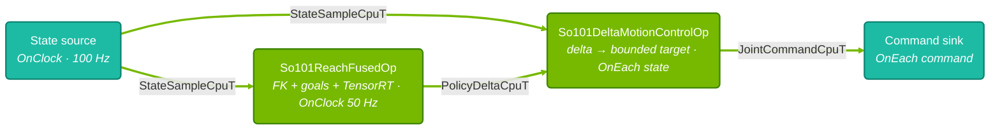

{/*
SPDX-FileCopyrightText: Copyright (c) 2026 NVIDIA CORPORATION & AFFILIATES. All rights reserved.
SPDX-License-Identifier: Apache-2.0
*/}

# SO-101 Reach Task - Part 3: Deploying the Policy

<Note>
Deploy an SO-101 reach policy with Isaac OS: configure the application, check it
without hardware, calibrate the arm and run closed-loop control. Use the default
policy the build downloads, the policy from [Part 1](/isaac-os/tutorials/so101-reach/training),
or a compatible ONNX export.
Run it against a simulated arm first with
[Part 2: Simulation](/isaac-os/tutorials/so101-reach/simulation).
</Note>

# Prerequisites

Before starting, ensure you have:

1. **Isaac OS repo** cloned and Docker image built —
   see [Getting Started](/isaac-os/tutorials/getting-started).

2. **A CUDA-capable GPU.**  Every run mode builds a TensorRT engine from
   the policy and refuses to start without a device.

3. **SO-101 hardware** — a calibrated arm connected via USB.

   - Follow [LeRobot's SO 101 setup](https://huggingface.co/docs/lerobot/so101)
     for assembly and calibration.

   - **Grant your user access to the serial port:**

     ```bash
     sudo setfacl -m u:$USER:rw /dev/ttyACM0
     ```
     `./isaac_os` runs the container as your user without the `dialout` group, so without
     this ACL the application cannot open the port.
     The ACL is lost when you reboot or replug the robot, so re-run the command then. If
     the robot enumerates as another node, such as `/dev/ttyACM1`, adjust the path and
     `real_robot.serial_port` to match.

4. **Optionally, a policy you trained** in Part 1, exported as ONNX with
   a float32 `obs` input of shape `[1, 20]` and a float32 `actions` output
   of shape `[1, 4]`.  The application verifies both tensors against the
   engine at startup and refuses to run otherwise.  Without one, it runs
   the default policy the build downloads.

   The runtime does not read the IO descriptor; you copy its values into the YAML in
   [Configuration](#configuration).

# How the Application Works

- **State source** — reads Feetech positions and velocities at 100 Hz; mock mode emits a constant pose.
- **Policy** — `So101ReachFusedOp` computes fingertip FK and the observation, then runs TensorRT at 50 Hz.
- **Motion control** — bounds each policy delta against the freshest measurement on every state.
- **Command sink** — writes servo positions; mock mode validates each command.



The controller runs on every state and holds the latest policy target for up to
`motion_control.target_expiry`, decoupling the 50 Hz policy from the 100 Hz commands.
The [architecture reference](/isaac-os/reference/applications/so101-reach#architecture)
covers partitions, connections, and the staleness and fault rules.

# Building the Application

```bash
./isaac_os build so101_reach
```
The build downloads the default
[policy model](/isaac-os/reference/applications/so101-reach#policy-model).

To list the run modes:

```bash
./isaac_os modes so101_reach
```
# Configuration

All tunable parameters live in
`applications/so101_reach/config/so101_reach_config.yaml`.

The binaries take `--config-path` and read the file before the graph
compiles.  There is no `--override` flag, so experiments are made on a
copy of the YAML rather than by overriding keys on the command line.

## Policy

```yaml
policy:
  onnx_path: "data/grip_reach_delta_policy_onnx/policy_fingertip_delta.onnx"
  inference_period: 0.02
  action_clip: 1.0
  default_joint_position: [0.0, 0.0, 0.0, 1.5700000524520874, 0.0, 0.0]
```
To deploy your Part 1 policy, set `policy.onnx_path` to your file outside
`data/grip_reach_delta_policy_onnx/` and copy the four IO-descriptor values:

| IO descriptor field | YAML key |
| --- | --- |
| `actions[0].scale` | `motion_control.action_scale` |
| `default_joint_pos_limits` of the four actuated joints | `motion_control.joint_pos_limits_lower` and `_upper` |
| `joint_pos_offsets` | `policy.default_joint_position` |
| `scene.dt` | `policy.inference_period` |

## Robot Hardware

```yaml
real_robot:
  serial_port: "/dev/ttyACM0"
  calibration_file: "PLACEHOLDER_PATH_TO_FOLLOWER_CALIBRATION_FILE.json"
  run_speed: 1500
  run_acceleration: 60
  position_p_gain: 16
  position_i_gain: 16
  position_d_gain: 32
  home_position: [0.0, 0.0, 0.0, 1.5708, 0.0, 0.0]
```
- `serial_port` — USB device for the Feetech bus.
- `calibration_file` — path to the LeRobot calibration JSON (see
  [calibration](#calibration) below).  The shipped placeholder is rejected at
  startup.

<Warning>

Keep `position_i_gain` non-zero. With LeRobot's default I = 0,
`shoulder_lift` and `elbow_flex` cannot lift the arm's weight, which looks like a bad policy.

</Warning>

The [configuration reference](/isaac-os/reference/applications/so101-reach#configuration)
explains every key, and the
[hardware notes](/isaac-os/reference/applications/so101-reach#hardware-notes) explain
the servo gains and speed.
<a id="calibration"></a>

# Calibration

The SO-101 requires a LeRobot calibration JSON file that maps motor IDs
to joint names and homing offsets.  The expected format:

```json
{
  "shoulder_pan":  {"id": 1, "drive_mode": 0, "homing_offset": 0, "range_min": 0, "range_max": 4095},
  "shoulder_lift": {"id": 2, "drive_mode": 0, "homing_offset": 0, "range_min": 0, "range_max": 4095},
  "elbow_flex":    {"id": 3, "drive_mode": 0, "homing_offset": 0, "range_min": 0, "range_max": 4095},
  "wrist_flex":    {"id": 4, "drive_mode": 0, "homing_offset": 0, "range_min": 0, "range_max": 4095},
  "wrist_roll":    {"id": 5, "drive_mode": 0, "homing_offset": 0, "range_min": 0, "range_max": 4095},
  "gripper":       {"id": 6, "drive_mode": 0, "homing_offset": 0, "range_min": 0, "range_max": 4095}
}
```
Motor IDs must be contiguous starting from 1.  The joint order must
match: `shoulder_pan`, `shoulder_lift`, `elbow_flex`,
`wrist_flex`, `wrist_roll`, `gripper`.

<Note>

LeRobot writes the file to
`~/.cache/huggingface/lerobot/calibration/robots/so_follower/<robot.id>.json`.
The directory is `so_follower`, not `so101_follower`: LeRobot 0.6.1
shares one calibration directory across the SO-100 and SO-101 followers.

</Note>
Pose each joint at true mid-travel before pressing Enter during
calibration, and hold the gripper half-open.  Calibrate *before* running
the application: torque stays enabled after the application exits, and a
torqued joint cannot be hand-posed, so power-cycle the arm before
recalibrating.

Since the application runs inside Docker, host paths are not visible by
default, and the `real_robot` keys are read straight from the YAML.
Copy the config, point it at the mounted calibration file, and mount the
directory.

Copy the config:

```bash
cp applications/so101_reach/config/so101_reach_config.yaml build/so101-reach-real.yaml
```
Then set `real_robot.calibration_file` in the copy to the absolute
mounted path.  `./isaac_os` sets `HOME=/workspace/isaac_os` inside the
container, so `$HOME` there resolves to the repository rather than your
home directory.

Mount the calibration directory:

```bash
export ISAAC_OS_EXTRA_DOCKER_RUN_ARGS="-v $HOME/.cache/huggingface/lerobot:$HOME/.cache/huggingface/lerobot"
```
`$HOME` inside the `-v` flag is fine: the host shell expands both
sides before Docker sees them.

# Validating Without Hardware

`mock` mode runs the same policy and motion controller against a
synthetic state source, so it exercises the temporal contracts, the
TensorRT engine, and the command bounds before the arm is involved:

```bash
./isaac_os run so101_reach mock
```
**Success criterion:** the command exits with status 0. A failed run logs
`The SO-101 TensorRT mock graph did not produce valid joint commands.`

The default run stops after 100 commands — about one second at 100 Hz —
and gives up if they do not arrive within 30 s.  For a longer run:

```bash
./isaac_os run so101_reach mock --run-args='--message-count=6000 --completion-timeout-seconds=120'
```
<Note>

The mock state source publishes a constant pose and never integrates
the commands it receives, so the fingertip never approaches a goal.
Any run longer than `policy.goal_hold_time` logs goal timeouts by
design.  Mock mode validates plumbing, not reach behavior.

</Note>
<Tip>

To run the same policy against a simulated arm that responds to commands, follow
[Part 2: Simulation](/isaac-os/tutorials/so101-reach/simulation).

</Tip>

# Running on Real Hardware

## Safety Checklist

Before running:

- Clear 1 m radius around the robot.
- Verify joints can move freely.
- Have an emergency stop ready (power disconnect).
- Ready to kill the process (Ctrl+C).

Keep the workspace clear for the first homing motion in particular:
`home_position` puts `wrist_flex` at 1.5708 rad, so the arm moves
there before the policy takes over.

<Warning>

Motors stay in torque mode after the application exits, so the arm does
not free-fall. Do **not** manually move joints while torque is enabled.
Unplug the robot before repositioning.

</Warning>

## Running

With the config copied and the calibration directory mounted:

```bash
./isaac_os run so101_reach real --run-args="--config-path=build/so101-reach-real.yaml" 2>&1 | tee build/reach-real.log
```
To stop after a fixed number of commands instead of running until Ctrl+C:

```bash
./isaac_os run so101_reach real --run-args="--config-path=build/so101-reach-real.yaml --message-count=3000" 2>&1 | tee build/reach-real.log
```
On a run with a cold engine, the arm homes and then holds still while TensorRT builds the
engine.

## Read the Result

Filter the log for goal outcomes:

```bash
grep -E 'Reached goal|timed out|Completed all' build/reach-real.log
```

**Success criterion:** the arm moves toward each goal, and the log shows `Reached goal`
lines. A run that lasts through the whole sequence also logs a `Completed all 9 goals`
line with the number achieved; the 3,000-command run can end before that line.

<Accordion title="❓ What happens during startup and shutdown?">

Startup order matters for bring-up. The YAML is decoded and validated and the graph is
compiled before the driver opens the serial port, so a bad config or an unbuildable graph
fails while the arm is still idle. The driver then applies calibration, PID, and gripper
protection, enables torque, and homes the arm.

The TensorRT engine is built after that, when the graph starts. A run with a cold engine
therefore homes the arm and then holds it in place for the length of the engine build, and
a missing or malformed ONNX is reported at that point rather than before homing.

On shutdown, the command sink writes the present positions back as the goal. Every command
is `measured + delta` — a position the arm has not reached yet — so closing the serial
port alone would leave the servos driving toward the last target after the process exits.

</Accordion>

# Troubleshooting

<Accordion title="⚠️ Startup and motion problems">

| Issue | Solution |
| --- | --- |
| "requires a calibration file instead of a placeholder" | Set `real_robot.calibration_file` in your config copy and pass it with `--config-path` |
| "No CUDA device is available" | Every mode needs a GPU; `mock` exits 77 so CTest reports it skipped |
| Policy tensor shape or direction error at startup | Export the ONNX with a float32 `obs` `[1, 20]` input and a float32 `actions` `[1, 4]` output |
| "Unable to read the SO-101 joint state" | Check the serial connection and permissions (`setfacl`) |
| "requires the expected six-joint calibration order" | Verify the calibration file's motor IDs and joint order |
| Arm follows in x and y but will not lift | Raise `real_robot.position_i_gain`; see the hardware warning above |
| Jerky or unstable motion | Reduce `motion_control.motion_max_step_size` or `motion_control.action_max_step_size` |
| No commands reach the arm | The controller drops stale targets; check for bus read failures in the log and whether `motion_control.target_expiry` is too tight for the configured policy period |

</Accordion>

# Summary

In this part you learned how to:

1. **Configure the policy and hardware keys.**
2. **Validate without hardware** — `mock` mode as a contract and
   engine check.
3. **Run on hardware and judge the result** — configure calibration,
   confirm the arm moves toward its goals, and read the goal logs.

## Next Steps

- [Part 4: Benchmark](/isaac-os/tutorials/so101-reach/benchmark) —
  measure the pipeline's latency and cadence with Nsight Systems.
