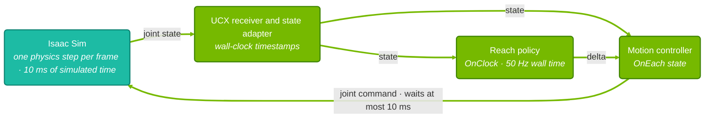

{/*
SPDX-FileCopyrightText: Copyright (c) 2026 NVIDIA CORPORATION & AFFILIATES. All rights reserved.
SPDX-License-Identifier: Apache-2.0
*/}

# SO-101 Reach Task - Part 2: Simulation

<Note>
Run the SO-101 reach policy against a simulated arm in Isaac Sim before deploying it on
hardware. You configure a policy, run a bounded closed-loop session, read the result, and
check the loop timing and what the simulation does not show. Use the policy from
[Part 1](/isaac-os/tutorials/so101-reach/training) or
the default policy the build downloads, then continue with
[Part 3: Deployment](/isaac-os/tutorials/so101-reach/deployment).
</Note>

# Prerequisites

Before starting, ensure you have:

1. **The Isaac OS repository** cloned and its Docker image built. See
   [Getting Started](/isaac-os/tutorials/getting-started).
2. **A CUDA-capable GPU.** The policy runs through TensorRT in every mode.
3. **Isaac Sim 6.2.0.1** set up with the [Isaac Sim guide](/isaac-os/how-to/set-up-isaac-sim).
4. **Optionally, your Part 1 export:** the `policy.onnx` and its IO descriptor YAML.

# What the Simulation Checks

The `sim` mode runs the same policy and motion controller as the real arm in
[Part 3](/isaac-os/tutorials/so101-reach/deployment). Only the ends of the graph change:
joint states arrive from Isaac Sim over UCX, and joint commands go back the same way.
Simulated positions respond to commands, so the policy closes the loop and the fingertip
travels to each goal.

This makes the simulation a check of the deployment pipeline. It shows that your policy,
configuration, joint order, frames and timing work together. It does not show that the
real arm moves like the simulated one; see
[What the Simulation Does Not Show](#what-the-simulation-does-not-show).
A custom scene must keep the joint order, units and frames the policy was trained with;
see the [Isaac Sim reference](/isaac-os/reference/applications/so101-reach#isaac-sim).

# Build and Check the Graph

Build the application and compile the simulation graph without starting a simulator:

```bash
./isaac_os build so101_reach
./isaac_os run so101_reach sim --run-args='--compile-only'
```

The second command ends with
`SO-101 reach simulation graph compiled. No simulator connection was opened.`

# Configure the Policy

As shipped, the application runs the default policy, so with it you can go straight to
[Start Isaac Sim](#start-isaac-sim).

<Accordion title="Use your Part 1 policy">

To run your own export, copy it to a path inside the repository, outside
`data/grip_reach_delta_policy_onnx/`, which the build overwrites:

```bash
mkdir -p build/reach_policy
cp <your-checkpoint>/exported/policy.onnx build/reach_policy/policy.onnx
```

In `so101_reach_config.yaml`, set `policy.onnx_path` to `build/reach_policy/policy.onnx`.
Then copy these values from your IO descriptor:

| IO descriptor field | YAML key |
| --- | --- |
| `actions[0].scale` | `motion_control.action_scale` |
| `default_joint_pos_limits` of the four actuated joints | `motion_control.joint_pos_limits_lower` and `_upper` |
| `joint_pos_offsets` | `policy.default_joint_position` |
| `scene.dt` | `policy.inference_period` |

The application checks the tensors at startup. The policy needs a float32 `obs` input of
shape `[1, 20]` and a float32 `actions` output of shape `[1, 4]`, and it must output joint
position deltas. See the
[SO-101 reach configuration](/isaac-os/reference/applications/so101-reach#configuration).

</Accordion>

The first run with a new ONNX builds a TensorRT engine and caches it beside the model.
Later runs load the cached engine.

# Start Isaac Sim

Start the reach scene headless in one terminal:

```bash
./isaac_sim run --scene operators/so101/assets/so101_reach_ucx_with_env.usda -- --headless
```

The first start fills the simulator caches and can take several minutes. Later starts
take under a minute. You can start the policy before Isaac Sim is ready: it waits for
the connection.

Headless mode keeps each simulation step short, which matters for the timing check below.
To watch the arm move, start Isaac Sim without `-- --headless` instead.

# Run a Bounded Session

Run the policy in a second terminal and keep a copy of the log:

```bash
./isaac_os run so101_reach sim --run-args='--message-count=3000' 2>&1 | tee build/reach-sim.log
```

`--message-count=3000` stops the run after 3,000 joint states from the simulator. That is
about 50 seconds at the simulator's usual speed, enough for two passes over the goal grid.

Isaac Sim starts playback when the application connects. When the run ends, the simulator
resets the arm and waits for the next connection, so you can repeat the run without
restarting it. Stop a run early with Ctrl+C.

# Read the Result

The policy walks a grid of nine goals and logs every step:

```text
Prepared a 1x3x3 goal grid with 9 goals; hold time 10.0s, settle time 1.0s, and tolerance 0.050m.
Starting goal 1/9 at [0.2000, -0.1120, 0.1360] (initial).
Distance to goal 1/9: 0.2384m.
Goal 1/9 is within tolerance; holding for 1.0s.
Reached goal 1/9 (distance 0.0081m, 1/1 completed).
Starting goal 2/9 at [0.2000, 0.0000, 0.1360] (reached).
...
Completed all 9 goals (9/9 achieved, 100.0%).
```

A goal counts as reached once the fingertip stays within 5 cm for one second. A goal that
is not reached within 10 seconds logs a `timed out` line with the fingertip position, and
the policy moves on. `Distance to goal` lines appear every two seconds while the fingertip
is outside the tolerance.

Filter the log for the result:

```bash
grep -E 'Reached goal|timed out|Completed all' build/reach-sim.log
```

**Success criterion:** the first `Completed all 9 goals (9/9 achieved, 100.0%)` line
appears before any `timed out` line.

<Accordion title="📄 Example results">

These results come from three headless runs of the default policy and configuration:

| Measure | Result |
| --- | --- |
| First pass over the grid | 9/9 goals in 21.1-21.4 s after connecting |
| Final fingertip distance per goal | 5.4-23.4 mm, against a 50 mm tolerance |
| Goals reached in 3,000 joint states | 20-21 |
| Timeouts | 0 |

They were measured with Isaac Sim 6.2.0.1 on an NVIDIA RTX 5880 Ada Generation GPU shared
with other workloads. Test date and commit were not recorded.

</Accordion>

Goal timers use wall time, so a much slower host can time out goals that the policy would
otherwise reach.

# Check the Loop Timing

The simulator, the policy and the controller run on different clocks:



Each simulator frame advances physics by 10 ms, publishes the joint state and waits up to
10 ms for a command. The controller sends one command per state while it holds a fresh
policy target. The policy runs every 20 ms of wall time on the freshest state. If the
simulator runs slower than real time, the policy acts more often per physics step than it
did in training.

When the run stops, the application prints a summary:

```text
Ran 2353 reach policy inferences in 47.9s and skipped 43 without a fresh joint state.
Sent 2986 joint commands for 2999 joint states; 12 policy targets expired before the next one arrived.
Received 3000 simulated SO-101 joint states; 0 repeated the previous physics step.
```

Read it line by line:

- **Repeated physics steps** should be zero. A repeated step means the simulator sent a
  frame without advancing physics. If it is not, see [Troubleshooting](#troubleshooting).
- **Skipped inferences** happen when no joint state arrived in the last 20 ms. A few are
  normal. Many mean that simulator frames take longer than 20 ms.
- **Expired policy targets** happen when no new policy output arrived within 40 ms. The
  controller sends no command for those states and the arm holds its last target. If every
  target expires, frames take longer than 40 ms and the arm never leaves its start pose.

Isaac Sim also logs receive-timeout warnings in its Kit log; the
[Isaac Sim reference](/isaac-os/reference/applications/so101-reach#isaac-sim) explains
which ones are expected.

# What the Simulation Does Not Show

The simulated arm uses the SO-101 system-identification asset, so its start pose, drives,
speed and time base differ from the real arm. Good simulation results check the pipeline;
only hardware shows actuator behavior such as how quickly a loaded servo closes a 0.05 rad
error, overshoot, and settling under gravity. The
[servo speed and acceleration diagnostic](/isaac-os/reference/applications/so101-sinus-motion#measure-servo-speed-and-acceleration)
measures step responses on the real arm. Validate motion on the real arm in Part 3.

<Accordion title="❓ How does the simulated arm differ from the real one?">

| Aspect | Simulation | Real arm |
| --- | --- | --- |
| Start pose | Asset pose, every joint at 0 rad | Homes to `real_robot.home_position`, with `wrist_flex` at 1.5708 rad |
| Position control | PhysX proportional-derivative drive per joint | Feetech servo position loop with P = 16, I = 16, D = 32 |
| Elbow drive | Damping raised to the shoulder pan's value to stop a 2 Hz oscillation | Servo gains as above |
| Joint speed | Limited to about 30 rad/s; the elbow settles near 0.2 rad/s while each command is limited to 0.05 rad | Capped by `real_robot.run_speed` 1500 at about 2.3 rad/s |
| Joint friction and armature | Authored only for the Newton physics engine, so the PhysX simulation runs without them | Physical |
| `kp` and `kd` in each command | Ignored by Isaac Sim | Ignored by the Feetech driver |
| Time base | As fast as the host allows, below real time on a busy host | Real time |

</Accordion>

# Troubleshooting

<Accordion title="⚠️ Simulation problems">

| Issue | Solution |
| --- | --- |
| The run ends with "peer disconnected" and "No simulated SO-101 joint states were received." | Isaac Sim stopped during the run or listens on a different port. Keep Isaac Sim running for the whole session. If the Isaac Sim terminal reports `Address already in use`, another program holds the port: set `sim_so101.port` in `so101_reach_config.yaml` and pass the same port with `-- --headless --port <port>` |
| Many skipped inferences or expired targets | Run Isaac Sim headless and stop other GPU or CPU-heavy work, such as builds |
| Repeated physics steps in the summary | Set `startTimeCode` and `endTimeCode` in the scene's root layer |
| The arm oscillates in a custom scene | Check the joint drive damping against the reach layer's elbow setting |
| Policy tensor shape error at startup | Export the ONNX with a float32 `obs` `[1, 20]` input and a float32 `actions` `[1, 4]` output |

</Accordion>

# Summary

In this part you learned how to:

1. **Run a policy in Isaac Sim**: build, configure an exported policy and run a bounded
   closed-loop session.
2. **Judge the run**: read goal logs against a clear success criterion.
3. **Check the timing**: read the run summary for repeated steps, skipped inferences and
   expired targets.
4. **Know the limits**: which differences between the simulated and real arm need hardware.

## Next Steps

- [Part 3: Deployment](/isaac-os/tutorials/so101-reach/deployment): calibrate the
  arm and run the policy on hardware.
- [Part 4: Benchmark](/isaac-os/tutorials/so101-reach/benchmark): measure the pipeline's
  latency and cadence.
- [SO-101 reach reference](/isaac-os/reference/applications/so101-reach#isaac-sim): every
  `sim` mode option and timing detail.
